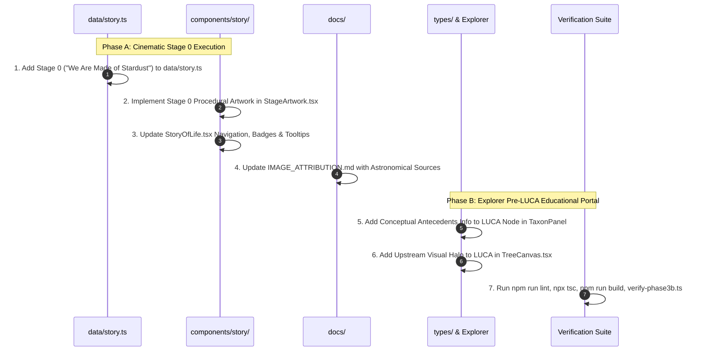

# ARCHITECTURE & SCIENTIFIC AUDIT PLAN
## Connecting Cosmic History, Prebiotic Chemistry, FUCA, and LUCA in the TREE OF LIFE Project

**Document Version:** 1.0.0  
**Status:** PROPOSED & AUDITED (Pending Approval — No Code Changes Executed)  
**Target Scope:** Integration of Cosmic History, Prebiotic Abiogenesis, FUCA Conceptualization, and the Biological Tree of Life  
**Dataset Invariance:** 92 Biological Nodes Preserved Intact; Single Root `luca` Maintained  

---

## Executive Summary & Foundational Scientific Principles

The objective of this architectural plan is to establish a rigorous, seamless bridge connecting:
1. **Cosmic History & Astrochemical Nucleosynthesis** (~13.8 BYA – 4.54 BYA),
2. **Prebiotic Planetary Chemistry & Abiogenesis** (~4.54 BYA – 3.8 BYA),
3. **The First Universal Common Ancestor (FUCA) and Pre-LUCA Lineages** (Hypothetical, ~4.0 – 3.8 BYA), and
4. **The Last Universal Common Ancestor (LUCA) & the Biological Tree of Life** (~3.8 BYA – Present).

### The Golden Scientific Invariant: Non-Cladistic vs. Cladistic Separation
A critical category error in popular science visualization is attempting to force non-biological, astrochemical, and geological phenomena into a biological phylogenetic tree. 
- **Biological Phylogeny (Cladistics):** Operates strictly on organismal descent, cellular replication, genetic inheritance, and speciation. Nodes represent taxa; edges represent parent-child ancestral lineages.
- **Cosmochemical & Prebiotic History:** Operates on nuclear physics, astrophysics, thermodynamics, mineral catalysis, and geochemical cycles. Stars, supernovae, accretion disks, and hydrothermal mineral chimneys do **not** possess genomes, do **not** reproduce via cell division, and **cannot** be modeled as biological taxonomic ancestors (`parentId`).

Therefore, this architecture strictly mandates that:
> **Cosmic History and Prebiotic Chemistry must be structured as an Upstream Geochemical / Environmental Epoch Layer and Narrative Chronicle, NEVER as cladistic parent nodes of LUCA in the 92-node biological dataset.**

---

## 1. Current Architecture Audit & File Inventory

An exhaustive inspection of the current `tree-of-life` codebase was conducted. The following core components, data structures, and verification suites define the current system state:

### A. The 92-Node Biological Dataset (`data/tree.ts`)
- **Root Node:** Single root `luca` (`id: "luca"`, `parentId: null`, `rank: "root"`, `estimatedOriginMya: 3800`).
- **Tree Topology:** Strictly acyclic, directed graph of 92 verified taxa spanning Bacteria, Archaea, and Eukaryota.
- **Invariants:** Every non-root node has a valid non-null `parentId`. All nodes are reachable from `luca`. Zero cycles exist.
- **Integrity Enforcement:** Validated continuously by `scripts/verify-phase3b.ts`.

### B. The Tree Layout & Navigation Engine (`lib/tree-layout.ts`, `components/tree/TreeCanvas.tsx`)
- **Layout Model:** Horizontal Reingold-Tilford hierarchy initialized via `assignPositions(treeData.rootId, 0, 0, ...)`.
- **Canvas Coordinates:** LUCA is anchored at $x = 80$, with depth increments extending rightward to modern taxa at $x \approx 3140$.
- **Camera System:** Smooth pan, zoom (scale 0.12 to 5.0), default Homo sapiens focus (scale 0.85), distinct `resetView()` (focuses Homo sapiens) and `fitTree()` (fits all 92 nodes at scale ~0.23).
- **Minimap:** Dedicated bottom-left orientation (`components/tree/TreeMinimap.tsx`) decoupled from controls and terminal taxa branches.

### C. The Temporal Coordinate System (`components/timeline/EvolutionTimeline.tsx`)
- **Time Bounds:** Currently hard-bounded to `minMya = 0` (Present) to `maxMya = 4000` (4.0 BYA, Late Hadean/Early Archean).
- **Mapping:** Linear interpolation mapping `myaToWorldX(mya)` across the horizontal layout width from LUCA (~3.8 BYA) to modern species (~0 MYA).
- **Key Observation:** The timeline currently begins around 4.0 BYA. Expanding this single linear axis back to the Big Bang (13,800 MYA) would compress the entire 3.8-billion-year history of life into the final 27% of the canvas, leaving 73% of the horizontal screen space as an empty, organism-free void.

### D. The Taxonomic Panel & Ancestor Traversal (`components/panel/TaxonPanel.tsx`)
- **Classification Chain:** Traverses `current.parentId` until `current.parentId === null`.
- **Behavior:** Traces ancestry directly from any selected taxon back to `LUCA`. If a non-biological node were added as a parent of LUCA, the classification chain for *Homo sapiens* would erroneously report: `Homo sapiens → Homo → ... → LUCA → Solar Nebula → Big Bang`.

### E. Narrative Engine (`data/story.ts`, `components/story/StoryOfLife.tsx`, `components/story/StageArtwork.tsx`)
- **Structure:** Sequential multi-stage cinematic experience.
- **Stage 0 Integration:** Stage 0 (*“We Are Made of Stardust”*, `stageNumber: 0`) introduces cosmic nucleosynthesis and CHNOPS before transitioning to Stage 1 (*“The Prebiotic Cradle”*).
- **Navigation Controls:** Segmented progress timeline, previous/next handlers, keyboard shortcuts (`Space`, `ArrowLeft`, `ArrowRight`, `Escape`, `Enter`), and direct completion routing to `/explorer`.

---

## 2. Conceptual Design: The Cosmic History Layer

To represent the cosmic antecedents of life without corrupting the biological tree, we propose an independent, multi-tiered **Cosmic History Layer**:

```
┌─────────────────────────────────────────────────────────────────────────────┐
│                          COSMIC HISTORY LAYER                               │
│                   (~13.8 Billion Years Ago – ~4.54 BYA)                     │
├─────────────────────────────────────────────────────────────────────────────┤
│ 1. Primordial Nucleosynthesis (Big Bang: H, He, trace Li)                  │
│ 2. Stellar Nucleosynthesis (Pop III Stars, Core Fusion: C, N, O up to Fe)   │
│ 3. Neutron-Capture Energetics (Supernovae s/r-process, Kilonovae: Heavy El) │
│ 4. Interstellar Medium Enrichment & Molecular Dust Clouds                   │
│ 5. Solar Nebula Collapse (~4.6 BYA) & Planetary Accretion                   │
│ 6. Consolidated Earth & Volatile Delivery (~4.54 BYA)                       │
│ 7. The CHNOPS Elemental Inventory (Chemical Prerequisites of Biochemistry)  │
└──────────────────────────────────────┬──────────────────────────────────────┘
                                       │ Non-Cladistic Geochemical Inheritance
                                       ▼
┌─────────────────────────────────────────────────────────────────────────────┐
│                      PREBIOTIC CHEMISTRY & ABIOGENESIS                      │
│                           (~4.54 BYA – ~4.0 BYA)                            │
├─────────────────────────────────────────────────────────────────────────────┤
│ • Volcanic outgassing & condensed liquid water oceans (~4.4 BYA zircons)    │
│ • Abiotic synthesis (amino acids, nucleobases, lipid vesicles, ribozymes)   │
│ • Geochemical gradients: Hydrothermal vent chimneys / Geothermal pools      │
│ • The "RNA World" & proto-metabolic iron-sulfur cycles                      │
└──────────────────────────────────────┬──────────────────────────────────────┘
                                       │ Transition across Darwinian Threshold
                                       ▼
┌─────────────────────────────────────────────────────────────────────────────┐
│                        FUCA (HYPOTHETICAL / EXTINCT)                        │
│                           (~4.2 BYA – ~3.8 BYA)                             │
├─────────────────────────────────────────────────────────────────────────────┤
│ • First Universal Common Ancestor: Emergence of compartmentalized genetics  │
│ • Lost communal protocell lineages, extensive lateral gene transfer         │
│ • Extinct sister stems with no surviving modern descendants                 │
└──────────────────────────────────────┬──────────────────────────────────────┘
                                       │ Phylogenetic Consolidation
                                       ▼
┌─────────────────────────────────────────────────────────────────────────────┐
│                    THE BIOLOGICAL TREE OF LIFE (92 NODES)                   │
│                           (~3.8 BYA – Present)                              │
├─────────────────────────────────────────────────────────────────────────────┤
│ • ROOT: LUCA (Last Universal Common Ancestor, ~3.8 BYA)                     │
│ • Universal genetic code, 20 L-amino acids, ribosomes, ATP synthase         │
│ • Domain Bacteria ──┬── Domain Archaea ── (Symbiogenesis) ── Eukaryota      │
│                     └──────────────────────────────────────── 92 Taxa Nodes │
└─────────────────────────────────────────────────────────────────────────────┘
```

### Seven Key Epochs of the Cosmic Layer:
1. **The Primordial Crucible (~13.8 BYA):** Big Bang nucleosynthesis. Expansion cools the universe sufficiently to synthesize hydrogen (~75%), helium (~25%), and trace lithium. Absence of all heavier elements.
2. **First-Generation Stellar Furnaces (~13.6–12 BYA):** Population III stars condense. Gravitational compression initiates hydrogen and helium core fusion, sequentially generating carbon, nitrogen, oxygen, neon, magnesium, silicon, and iron (Fe-56).
3. **Cataclysmic Nucleosynthesis & Dispersion:** Stellar fusion stops at iron due to nuclear binding energy limitations. Heavier elements (e.g., zinc, phosphorus, copper, selenium, iodine) are synthesized via slow and rapid neutron capture ($s$-process in AGB stars, $r$-process in core-collapse supernovae and binary neutron star kilonovae). Stellar winds and supernova shockwaves disperse elements into interstellar space.
4. **Interstellar Molecular Dust Clouds:** Shockwaves cool and compress gas into dense molecular clouds. Dust grains act as catalytic surfaces where cosmic ionizing radiation drives the formation of carbon monoxide, water ice, methane, formaldehydes, and complex polycyclic aromatic hydrocarbons (PAHs).
5. **Solar System Formation (~4.6 BYA):** Gravitational collapse of a local molecular cloud fragment forms the spinning accretion disk (the Solar Nebula), with the proto-Sun consolidating at the gravitational center.
6. **Earth Accretion & Differentiation (~4.54 BYA):** Refractory silicates and iron-nickel metal grains accrete through planetesimal impacts, forming proto-Earth. Core-mantle differentiation sequesters dense iron and siderophile elements into the core, while outgassing and chondritic impacts furnish the early crust, mantle, and volatile inventory.
7. **The CHNOPS Prebiotic Inventory:** The concentration of Carbon, Hydrogen, Nitrogen, Oxygen, Phosphorus, and Sulfur on early Earth provides the foundational chemical palette for organic chemistry.

---

## 3. Prebiotic Chemistry & Early Life (The Abiogenesis Narrative)

The transition from cosmic chemical enrichment to life must be presented with strict scientific categorization, clearly distinguishing empirical evidence from unresolved hypotheses.

### A. Established Scientific Evidence
- **Zircon Crystal Geochemistry (Jack Hills, Australia):** Demonstrates that solid crustal rocks, low-temperature granites, and liquid water oceans existed on Earth as early as ~4.404 billion years ago, rapidly following planetary accretion.
- **Abiotic Synthesis in Meteoritics:** Carbonaceous chondrites (e.g., Murchison, Winchcombe) contain over 70 distinct amino acids, purines, pyrimidines, polyols (sugar derivatives), and aliphatic hydrocarbons formed non-biologically in interstellar/protoplanetary ices.
- **Universal Biochemical Homology:** All known living cellular life utilizes identical L-amino acids for proteins, D-sugars for nucleic acids, an identical four-base genetic cipher, ribosomes, and homologous ATP synthase machinery, proving common ancestry from a unified population (LUCA).

### B. Leading Active Hypotheses
- **Alkaline Deep-Sea Hydrothermal Vents (Iron-Sulfur World):** Proposes that serpentinization reactions at submarine hydrothermal vents generated continuous proton ($\Delta pH$) and electrical potential gradients across micro-porous inorganic iron-sulfur mineral membranes, serving as natural inorganic protocells before lipid membranes evolved.
- **Subaerial Volcanic Geothermal Pools:** Proposes that wet-dry cycling on exposed volcanic islands drove non-enzymatic dehydration-condensation polymerization of nucleotides into RNA polymers and encapsulated them in fatty-acid vesicles.
- **The RNA World Hypothesis:** Postulates an early evolutionary phase where RNA functioned simultaneously as the informational carrier (genetic genotype) and the catalytic engine (phenotypic ribozyme) prior to the evolution of coded protein enzymes and DNA genomes.

### C. Major Unresolved Questions
- **The Abiogenesis Mechanism:** The exact geochemical pathway that bridged abiotic organic mixtures to self-maintaining, autocatalytic, membrane-bound, evolving metabolic networks remains unknown.
- **The Origin of the Genetic Code:** How specific trinucleotide codons became coupled to specific amino acids via aminoacyl-tRNA synthetases prior to LUCA remains an active frontier of structural biochemistry.
- **Pre-Darwinian Collectives vs. Cellular Individuals:** Whether early life existed as a communal continuum of loosely bounded vesicles exchanging genetic fragments before crossing the "Darwinian threshold" of discrete cellular speciation.

---

## 4. Scientific Audit: Representing FUCA and LUCA

### A. Scientific Definitions and Distinctions

| Feature | FUCA (First Universal Common Ancestor) | LUCA (Last Universal Common Ancestor) |
| :--- | :--- | :--- |
| **Full Name** | First Universal Common Ancestor | Last Universal Common Ancestor |
| **Scientific Status** | Theoretical / Conceptual Evolutionary Construct | Empirical Phylogenomic Inference |
| **Estimated Age** | **Highly Uncertain / Model-Dependent** (Hypothesized ~4.2–3.9 BYA in some models, but no consensus date exists) | ~3.8 – 3.5 BYA (Supported by molecular clocks & microfossil constraints) |
| **Physical Evidence** | **None** (Zero fossils, genomic traces, or surviving pre-LUCA sister lineages) | Substantial indirect genomic & biochemical homologies across all cellular life |
| **Biological Nature** | **Unknown / Unresolved** (Early communal protocells, RNA-peptide collectives, or primitive replicating system) | Reconstructed cellular organism (anaerobic, thermophilic, 64-codon cipher, ATP synthase) |
| **Descendants** | All life that ever arose from biogenesis, **including extinct pre-LUCA sister branches** | **Only the lineages that survived to the present** (Bacteria, Archaea, Eukaryota) |
| **Relationship** | Theoretical origin of biological replication | The empirical coalescence point of surviving modern cellular branches |

```
BIOGENESIS (Abiogenesis Threshold)
   │
   ▼
[ FUCA ] ── First Universal Common Ancestor (Theoretical construct — date & biology uncertain)
   │
   ├── Extinct Pre-LUCA Sister Lineage A (Extinct, lost in Hadean/Archean)
   ├── Extinct Pre-LUCA Sister Lineage B (Extinct, lost in Hadean/Archean)
   │
   ▼ (Hundreds of millions of years of lost evolutionary history & communal exchange)
[ LUCA ] ── Last Universal Common Ancestor (~3.8 BYA, Empirical 92-Node Biological Root)
   │
   ├── Bacteria
   └── Archaea ── (Symbiogenesis) ── Eukaryota
```

### B. Representation Rules for FUCA in Tree of Life
1. **Dating & Characterization Invariant:** Treat any hypothesized FUCA date range (such as ~4.2–3.9 BYA) as strictly tentative, uncertain, and model-dependent. Do not assign FUCA a precise date, specific anatomical traits, or definitive metabolic capabilities in the UI or data models without reliable, peer-reviewed citations.
2. **Strict Conceptual Distinction from LUCA:** FUCA and LUCA must never be conflated. LUCA is the empirically supported ancestor of surviving life; FUCA is the theoretical earliest universal common ancestor of all life (including extinct pre-LUCA dead ends).
3. **Do NOT Replace `luca` as the Dataset Root:** In `data/tree.ts`, `rootId` must remain `"luca"`. Replacing it with `fuca` would violate the Reingold-Tilford layout invariants, break parent-child references across the 92 nodes, and imply that we have a verified cladistic branch linking FUCA to modern Bacteria and Archaea, which is scientifically unjustified.
4. **Do NOT Invent Fictitious Parent-Child Nodes:** FUCA must not be inserted as a dummy cladistic node (`id: "fuca", parentId: null; id: "luca", parentId: "fuca"`) with synthetic dates and ranks.
5. **Represent FUCA as an Uncertainty-Qualified Antecedent:**
   - In **The Story of Life**, FUCA is framed in Stage 2 as an uncertain theoretical concept at the dawn of self-replication.
   - In **The Tree Explorer**, FUCA can be represented via an **"Antecedents & Origins" Drawer** attached to the LUCA node, clearly labeled as a *Theoretical / Conceptual Entity* with explicit uncertainty badges.

---

## 5. Story Integration Architecture

The narrative sequence in `components/story/` provides the ideal medium to tell this cosmic-to-biological story without compromising the mathematical graph of the Tree Explorer.

### The Nine-Stage Narrative Arc (0 through 7 + Prologue/Epilogue):
1. **Stage 0: Cosmic Origins — “We Are Made of Stardust” (~13.8 – 4.54 BYA)**
   - *Sections:* Big Bang Nucleosynthesis, Stellar Fusion Furnaces, Dispersion & Solar Nebula, CHNOPS Elements.
   - *Visual Theme:* Deep Space Cosmic Void (`#04010a`), Nebula Violet (`#a855f7`), Stellar Gold (`#fbbf24`).
2. **Stage 1: The Prebiotic Cradle (~4.54 – 4.0 BYA)**
   - *Sections:* Crustal cooling, Jack Hills zircons (~4.4 BYA), torrential primeval rains, hydrothermal vent systems.
   - *Visual Theme:* Magma Amber (`#f97316`), Volcanic Crust, Primordial Ocean.
3. **Stage 2: The Spark of Self-Replication & FUCA (~4.0 – 3.8 BYA)**
   - *Sections:* Lipid protocells, catalytic RNA ribozymes, the RNA World, the concept of FUCA as the initial spark of replication, lost pre-LUCA sister branches.
   - *Visual Theme:* Electric Cyan (`#06b6d4`), Hydrothermal Chimneys, Lipid Vesicles.
4. **Stage 3: The Deep Microbial Ocean & LUCA (~3.8 – 2.0 BYA)**
   - *Sections:* LUCA's emergence (~3.8 BYA), universal genetic code, divergence of Bacteria and Archaea, Cyanobacteria and the Great Oxidation Event (~2.45 BYA).
   - *Visual Theme:* Emerald Green (`#10b981`), Stromatolites, Banded Iron Formations.
5. **Stage 4: Eukaryogenesis & The Complex Cell (~2.0 – 0.54 BYA)**
   - *Sections:* Asgard archaeon engulfs alphaproteobacterium (mitochondrion), internal membranes, Ediacaran soft-bodied biota.
   - *Visual Theme:* Royal Purple (`#8b5cf6`), Eukaryotic Cells, *Dickinsonia*.
6. **Stage 5: The Explosion of Diversity & Land Invasion (~541 – 66 MYA)**
   - *Sections:* Cambrian Explosion, land colonization by plants and fungi, Carboniferous forests, tetrapods, dinosaurs.
   - *Visual Theme:* Coral Rose (`#ec4899`), Burgess Shale Marine Biota.
7. **Stage 6: The Twig of Humanity (~7 MYA – Present)**
   - *Sections:* Primate canopy, bipedal hominins, *Homo erectus*, emergence of *Homo sapiens* (~300,000 years ago).
   - *Visual Theme:* Sapphire Blue (`#3d8ef8`), Hominin Cranial Sequence.
8. **Stage 7: The Interconnected Tree (Present Day)**
   - *Sections:* 8.7 million species, planetary biodiversity, seamless invitation to enter the interactive Tree Explorer.
   - *Visual Theme:* Sky Blue (`#38bdf8`), Global Phylogenetic Tree.

### Navigation & UX Invariants:
- **Index 0:** Stage 0 (`stageNumber: 0`).
- **Indices 1–7:** Existing Stages 1 through 7.
- **Top Segmented Timeline:** 8 distinct segments with clear tooltips.
- **Bottom Navigation:** `Previous` disabled only on Stage 0; `Continue Journey` advances smoothly; `Skip to Explorer` remains available at all times.
- **Explorer Transition:** Direct transition to `/explorer` focuses on `homo-sapiens` at scale 0.85 with all controls accessible.

---

## 6. Dataset Integrity & Schema Risk Analysis

### A. Current Biological Dataset Invariance
- The 92 taxa in `data/tree.ts` represent **empirically validated biological clades** with taxonomic ranks, dates, and parent-child links.
- **No modification to `data/tree.ts` will occur during this expansion.**
- The single root `rootId: "luca"` remains 100% untouched.

### B. Future Schema Proposal: Non-Taxonomic Antecedents
If the interactive Explorer UI is later enhanced to display Cosmic History and FUCA directly within the canvas, the schema must introduce an **explicitly separate interface** to prevent schema contamination:

```typescript
// Proposed future types in types/taxonomy.ts (DO NOT IMPLEMENT YET)

export type PrebioticMilestoneType =
  | "cosmic_nucleosynthesis"
  | "stellar_process"
  | "planetary_formation"
  | "geochemical_cycle"
  | "abiogenesis_hypothesis"
  | "hypothetical_ancestor";

export interface PrebioticEntity {
  id: string; // e.g., "big-bang", "first-stars", "solar-nebula", "fuca"
  name: string;
  type: PrebioticMilestoneType;
  estimatedOriginMya: number;
  timeRangeDisplay: string;
  scientificStatus: "established_cosmology" | "active_hypothesis" | "theoretical_construct";
  description: string;
  chemicalSignificance: string; // e.g. "Synthesis of Carbon-12 via Triple-Alpha"
  relevantElements?: ("C" | "H" | "N" | "O" | "P" | "S")[];
  uncertaintyNotes: string;
  connectedTaxonRootId?: "luca"; // Non-cladistic reference to the biological root
}
```

### Risk Assessment of Schema Alterations:

| Scenario | Risk Level | Potential Impact | Architectural Mitigation |
| :--- | :--- | :--- | :--- |
| **Inserting FUCA into `data/tree.ts` as `parentId` of LUCA** | **HIGH (Breaking)** | Breaks `verify-phase3b.ts` root checks; invalidates `assignPositions` tree layout; corrupts `TaxonPanel` classification chain. | **Strictly prohibited.** LUCA remains `rootId`. FUCA is managed as a conceptual antecedent. |
| **Adding Cosmic Events to `data/tree.ts` as TaxonNodes** | **HIGH (Breaking)** | Distorts Reingold-Tilford tree width; treats physical events as taxonomic species; introduces category error. | **Strictly prohibited.** Cosmic events exist only in narrative data and dedicated overlay layers. |
| **Introducing a Parallel `PREBIOTIC_ENTITIES` Data Registry** | **LOW (Safe)** | Zero impact on `TREE_DATA`; biological tree remains 92 nodes; 100% backward-compatible. | **Recommended approach for future phases.** |

---

## 7. User Experience, Visual Semiotics & Navigation Architecture

To prevent public and scientific confusion, the user interface must enforce rigorous visual semiotics distinguishing between cosmological chronology, geochemical abiogenesis, and biological phylogenetics.

### A. Visual Semiotics Palette

```
┌─────────────────────────────────────────────────────────────────────────────┐
│ 1. COSMIC HISTORY LAYER (Astrophysical & Nucleosynthetic)                   │
│    • Accent Color: Deep Cosmic Violet (#a855f7) & Stellar Gold (#fbbf24)    │
│    • Visual Motif: Concentric shockwaves, dust lanes, atomic symbols        │
│    • Boundary Tag: "Astrochemical Origin · Non-Biological"                 │
├─────────────────────────────────────────────────────────────────────────────┤
│ 2. PREBIOTIC & FUCA LAYER (Geochemical & Protocellular)                     │
│    • Accent Color: Magma Amber (#f97316) & Electric Cyan (#06b6d4)         │
│    • Visual Motif: Vesicle bilayers, mineral chimneys, RNA helices          │
│    • Boundary Tag: "Prebiotic Frontier · Active Scientific Research"        │
├─────────────────────────────────────────────────────────────────────────────┤
│ 3. BIOLOGICAL TREE OF LIFE (Darwinian Phylogeny — 92 Nodes)                 │
│    • Accent Color: Living Chlorophyll (#10b981) & Primary Blue (#3d8ef8)   │
│    • Visual Motif: Continuous cladistic branching lines, living leaves      │
│    • Boundary Tag: "Verified Phylogenetic Tree · Root: LUCA (~3.8 BYA)"     │
└─────────────────────────────────────────────────────────────────────────────┘
```

### B. Explorer Integration: The Pre-LUCA Antecedents Portal
In the interactive Tree Explorer (`/explorer`):
1. **The Biological Canvas Remains Pure:** The Reingold-Tilford tree starts at LUCA ($x=80$) and branches outward.
2. **Upstream Halo on LUCA:** When LUCA is hovered or selected, a luminous upstream connector radiates toward the left edge with a subtle badge:
   `✨ Cosmic & Prebiotic Antecedents (FUCA, Prebiotic Earth & Stardust)`
3. **Dedicated Antecedents Drawer:** Clicking this halo or clicking a link in LUCA's `TaxonPanel` opens a specialized side drawer or overlay displaying:
   - The distinction between FUCA and LUCA.
   - The CHNOPS cosmic origin cards.
   - The transition from prebiotic geochemical gradients to cellular life.
   - A direct link: *“Experience the Cosmic Origins Cinematic Narrative”* which launches Stage 0.

---

## 8. Step-by-Step Implementation Sequence (For Future Execution)

When approved for implementation, the following staged roadmap will be followed:



---

## 9. Verification & Quality Assurance Test Plan

Any future implementation of this plan must pass the following verification battery:

### 1. Dataset Invariance Verification
- `npx tsx scripts/verify-phase3b.ts` must return **exit code 0**.
- Node count must remain **exactly 92**.
- Single root `luca` must remain strictly verified.
- Zero cycles and 100% reachability from `luca`.

### 2. Code Quality & Typing Verification
- `npm run lint` must pass with 0 errors and 0 warnings.
- `npx tsc --noEmit` must pass with 0 errors.
- `npm run build` must compile all pages (`/`, `/story`, `/explorer`) without Turbopack build errors.

### 3. Story Progression & UI Verification
- Verify that Stage 0 loads as the initial slide (`currentStageIndex === 0`).
- Verify that `Previous` is disabled on Stage 0.
- Verify that `Continue Journey` steps smoothly through Stage 0, Stage 1, up to Stage 7.
- Verify that clicking `Skip to Explorer` or completing Stage 7 seamlessly lands on `/explorer` focused on Homo sapiens.

---

## 10. Explicit Confirmation of Dataset Invariants

- **`data/tree.ts` Modification:** **NONE.** The file remains untouched during this audit.
- **Node Count:** Strictly **92 nodes**.
- **Root Taxon:** Strictly **`luca`**.
- **Parent-Child Integrity:** 100% preserved.
- **Phase 3C Boundary:** Respected; Phase 3C has not been started.

---

*Authored by Antigravity Agent for Google DeepMind & TREE OF LIFE Architectural Review.*  
*Ready for review and formal approval.*
