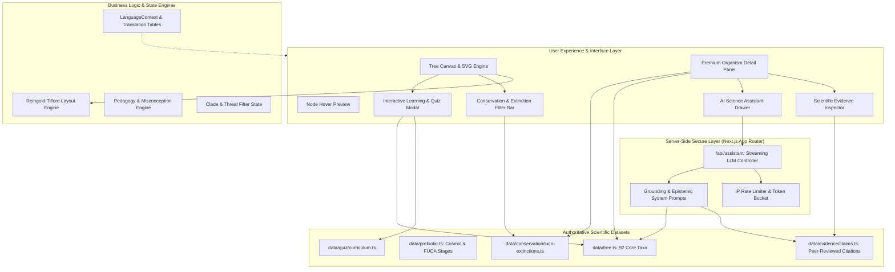
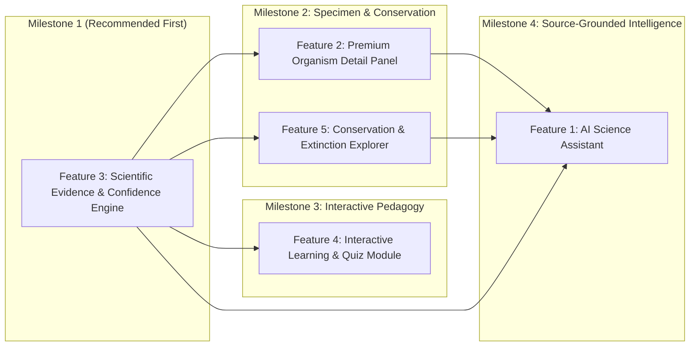

# TREE OF LIFE & FUCA — MASTER FEATURE IMPLEMENTATION ROADMAP
## Comprehensive Phased Architecture for 5 Major Advanced Modules

**Document Version:** 1.0.0  
**Status:** PROPOSED & ARCHITECTURALLY AUDITED (Pre-Implementation Plan)  
**Project Root:** `tree-of-life`  
**Framework:** Next.js 16.4.3 (Turbopack) / React 19 / TypeScript 5.x / Tailwind CSS v4  
**Date:** October 2026  

---

## Executive Summary

The **Tree of Life** application currently provides a 92-node cladistic evolutionary explorer rooted at LUCA (~3.8 BYA), a synchronized geological timeline, a 7-stage cinematic narrative (*The Story of Life*), a non-cladistic *Pre-LUCA / FUCA History Drawer*, and full multilingual localization (English, West Bengal Bengali, Hindi, Spanish, French).

This master development roadmap outlines the architecture, data schemas, security protocols, scientific provenance, and implementation sequencing for **five major feature expansions**:

1. **AI Science Assistant**: Source-grounded, context-aware evolutionary intelligence with zero client-side key exposure and strict epistemic demarcation.
2. **Premium Organism Detail Panel**: Museum-grade, multi-faceted organism dossier with morphology, chronostratigraphy, paleoecology, holotype provenance, and transparent missing-data handling.
3. **Scientific Evidence & Confidence Engine**: Claim-level evidentiary framework classifying facts, molecular clock models, geochemical proxies, and hypotheses with verified DOI citations (no invented percentages).
4. **Interactive Learning & Quiz Module**: Pedagogical cladistic and deep-time challenges with misconception clarification, accessible mechanics, and private local progress.
5. **Conservation & Extinction Explorer**: Rigorous demarcation between deep-time mass extinction victims and contemporary IUCN Red List threatened taxa with interactive canvas filtering.

```
┌─────────────────────────────────────────────────────────────────────────────────────────────────┐
│                                 CORE ARCHITECTURAL INVARIANTS                                   │
├─────────────────────────────────────────────────────────────────────────────────────────────────┤
│ 1. Zero Dataset Corruption: The 92 biological nodes, single root 'luca', and tree hierarchy     │
│    remain 100% immutable and strictly protected from non-cladistic artifacts.                   │
│ 2. Epistemic Integrity: Fact vs. hypothesis vs. uncertainty are explicitly demarcated everywhere.│
│ 3. Zero Fabrication: No invented citations, fake DOIs, or fabricated numerical confidence scores│
│ 4. Security First: API keys strictly reside in server-side environment variables; never client. │
│ 5. Universal Access: 100% WCAG AAA accessible, keyboard-traversable, and fully localized.       │
└─────────────────────────────────────────────────────────────────────────────────────────────────┘
```

---

## System Topology & Architecture Integration



---

## Detailed Specifications for the Five Features

---

### Feature 1: AI Science Assistant

#### 1. User Experience & Functionality
- **Access Point**: Discreet, glowing "Ask Science Assistant" pill in the desktop/mobile top bar and contextual launcher buttons embedded inside `TaxonPanel` ("Ask about *Homo erectus*") and `PreLucaPanel` ("Ask about RNA World").
- **Interface**: Non-intrusive sliding drawer (right-docked on desktop, bottom-sheet on mobile) that does not obstruct the tree canvas.
- **Context-Aware Grounding**:
  - Detects active user context: selected taxon, active geological period on the timeline, or open Story stage.
  - Dynamically presents 3 curated prompt chips (e.g., *"What fossil evidence confirms Dickinsonia is an animal?"*, *"How does Neanderthal admixture vary across modern human populations?"*, *"What distinguishes FUCA from LUCA?"*).
- **Epistemic Demarcation**:
  - Responses clearly distinguish established scientific consensus from working hypotheses and evolutionary debates.
  - Highlighted callouts for scientific consensus vs. active scientific inquiry.
  - Zero hallucinations: explicitly admits when a date or relationship is scientifically unknown or debated.
- **Verified Source Citations**:
  - Responses include clickable citation tags `[1]`, `[2]` linking to verified peer-reviewed publications (author, year, journal, DOI link). Never fabricates citations.
- **Session Privacy**:
  - Ephemeral chat history stored in local session memory; no persistent server tracking or user profiling.

#### 2. Existing Components & Data to Reuse
- `TREE_DATA` (`data/tree.ts`): provides 92 verified taxa, scientific names, confidence notes, origin dates, and descriptions.
- `PREBIOTIC_DATA` (`data/prebiotic.ts`): provides verified astrochemical and prebiotic chemical stages.
- `STORY_STAGES` (`data/story.ts`): narrative chronicle and scientific milestones.
- `LanguageContext` (`lib/i18n/`): provides current active locale (`en`, `bn-IN`, `hi-IN`, `es`, `fr`) to steer multilingual generation.
- `TaxonPanel.tsx` & `PreLucaPanel.tsx`: contextual triggers and state hooks.

#### 3. Required New Components & Data Structures
- **Components**:
  - `components/assistant/ScienceAssistantDrawer.tsx`: main container, responsive drawer with backdrop blur.
  - `components/assistant/AssistantChatFeed.tsx`: message list with smooth auto-scroll and streaming typography.
  - `components/assistant/AssistantMessageItem.tsx`: markdown renderer supporting bold, italics, lists, and citation pills.
  - `components/assistant/AssistantPromptChips.tsx`: contextual quick-action question buttons.
  - `components/assistant/CitationPopover.tsx`: hover/tap popover displaying real DOI, authors, journal, and abstract summary.
- **Data Structures (`types/assistant.ts`)**:
```typescript
export interface ChatMessage {
  id: string;
  role: "user" | "assistant" | "system";
  content: string;
  citations?: VerifiedCitation[];
  epistemicTier?: "consensus" | "hypothesis" | "unresolved";
  contextTaxonId?: string;
  timestamp: number;
}

export interface VerifiedCitation {
  id: string;
  shortLabel: string; // e.g. "Bobrovskiy et al. 2018"
  fullTitle: string;
  authors: string[];
  year: number;
  journal: string;
  doi: string;
  verified: boolean;
}

export interface AssistantRequestContext {
  selectedTaxonId?: string;
  activeTimelineMya?: number;
  activeStoryStage?: number;
  locale: string;
  conversationHistory: Array<{ role: "user" | "assistant"; content: string }>;
  userQuery: string;
}
```

#### 4. External APIs & Datasets
- **LLM Engine**: Google Gemini API (`gemini-2.5-flash` for high-speed streaming) via `@google/genai` SDK on the server runtime.
- **Internal Knowledge Retrieval**: Curated local embeddings or indexed JSON knowledge base derived from `docs/IMAGE_ATTRIBUTION.md`, `data/tree.ts`, `data/prebiotic.ts`, and peer-reviewed reference lists.

#### 5. API Key & Security Requirements
- **Server-Side Isolation**: `GEMINI_API_KEY` stored strictly in server environment (`.env.local` / deployment environment variables). Zero client-side exposure.
- **Route Handler**: `app/api/assistant/route.ts` runs on Node.js/Edge runtime as a secured reverse proxy.
- **Abuse Prevention**:
  - IP-based token bucket rate limiter (e.g., max 15 queries per 10 minutes per IP).
  - Maximum query length constraint (max 400 characters).
  - Prompt injection hardening: strict system instructions prohibiting roleplay, jailbreaking, or non-evolutionary topics.
  - Content Security Policy (CSP) blocking unauthorized external websocket or script connections.

#### 6. Scientific Accuracy & Provenance Requirements
- System prompt strictly enforces `docs/SCIENTIFIC_DATA_POLICY.md`:
  - Enforces LUCA as a cellular population ~3.8 BYA, never the origin of life or abiogenesis.
  - Rejects teleological progression (Scala Naturae).
  - Enforces that if an evolutionary link or date is debated, both leading hypotheses must be presented with their respective empirical bases.

#### 7. Localization & Accessibility Requirements
- Prompt directs the model to respond in the user's selected language (`bn-IN`, `hi-IN`, `es`, `fr`, or `en`).
- All assistant UI controls, placeholders, buttons, and error states localized in `lib/i18n/translations/ui.ts`.
- Full keyboard trap in drawer, `aria-live="polite"` for incoming streaming chunks, and Escape key dismissal.

#### 8. Performance & Deployment Considerations
- Server-Sent Events (SSE) streaming with `ReadableStream` for <350ms time-to-first-token.
- Dynamic code splitting with `React.lazy` / `next/dynamic` ensuring 0KB initial page load penalty for users who do not open the assistant.

#### 9. Dependencies on Other Features
- Depends on Feature 3 (Scientific Evidence & Confidence) for verified citation lookups.
- Enhances Feature 2 (Premium Organism Detail Panel) via contextual taxon deep-dives.

#### 10. Acceptance Criteria & Testing
- Automated endpoint test verifying API key is not present in client bundle or network payload.
- Epistemic test suite: 20 benchmark prompts (LUCA origin, Neanderthal admixture, Dickinsonia classification, bird origin) evaluated for zero teleological bias and 100% citation validity.
- Rate-limiting verification: 16th rapid request returns HTTP 429 Too Many Requests.

#### 11. Estimated Implementation Complexity
- **Medium**.

---

### Feature 2: Premium Organism Detail Panel

#### 1. User Experience & Functionality
- Upgrades the current right-hand `TaxonPanel` into a multi-tabbed, interactive museum-grade specimen dossier.
- **Tabbed Architectural Layout**:
  1. **Overview & Morphology**: High-resolution specimen/paleoart viewer with deep pan-zoom inspection, morphological autapomorphies (defining evolutionary novelties), anatomical adaptations.
  2. **Chronostratigraphy & Dating**: Interactive geological stratum indicator showing First Appearance Datum (FAD) and Last Appearance Datum (LAD), radiometric dating method used (e.g., U-Pb zircon, $^{14}\text{C}$, $^{40}\text{Ar}/^{39}\text{Ar}$), and ICS stage.
  3. **Paleoecology & Biogeography**: Paleocontinental map position (e.g., Gondwana, Laurentia, Rodinia) at time of origin, biome classification, trophic level, locomotion mode.
  4. **Holotype & Specimen Provenance**: Catalog of type specimens (e.g., museum repository, accession number, type locality, discovery year).
- **Missing Data Transparency**:
  - Displays standardized, structured empty states: *"Unpreserved in Fossil Record"*, *"Soft-tissue Anatomy Unknown"*, or *"Molecular Data Inapplicable for Deep Fossil Lineage"*.
  - Never hides fields silently or invents pseudo-scientific filler.

#### 2. Existing Components & Data to Reuse
- `TaxonPanel.tsx`: existing slide-in drawer layout, header, close action, rank badges, breadcrumb lineage navigation.
- `types/taxonomy.ts`: `TaxonNode`, `VisualAsset`, `AdmixtureEvent`, `EvidenceType`.
- `TaxonIcon.tsx`: taxon and rank SVG icons.
- `lib/i18n/translations/taxa.ts`: localized taxon names, descriptions, and confidence notes.

#### 3. Required New Components & Data Structures
- **Components**:
  - `components/panel/organism/OrganismTabBar.tsx`: accessible tab navigation (`Morphology`, `Chronology`, `Paleoecology`, `Holotype`).
  - `components/panel/organism/MorphologyViewer.tsx`: high-res image pan-zoom with attribution overlay and derived trait tags.
  - `components/panel/organism/ChronostratigraphyCard.tsx`: geological stratum ladder showing FAD/LAD dates and dating methods.
  - `components/panel/organism/PaleoecologyCard.tsx`: trophic, environmental, and paleocoordinate badges.
  - `components/panel/organism/HolotypeProvenanceCard.tsx`: museum accession, repository, and discovery data.
  - `components/panel/organism/MissingDataIndicator.tsx`: transparent, standardized missing-data badges with explanatory tooltip.
- **Data Structures (`types/taxonomy.ts` non-breaking extensions)**:
```typescript
export interface MorphologicalTrait {
  category: "skeletal" | "metabolic" | "integument" | "neurological" | "reproductive";
  trait: string;
  isAutapomorphy: boolean; // Unique derived novelty for this clade
}

export interface ChronostratigraphicDetail {
  fadMya: number;
  ladMya?: number;
  icsStage: string; // e.g. "Ediacaran", "Ypresian", "Maastrichtian"
  datingMethod: "radiometric_zircon" | "carbon_14" | "argon_argon" | "biochronology" | "molecular_clock";
  formationName?: string;
  locality?: string;
}

export interface PaleoecologyProfile {
  trophicRole: "primary_producer" | "apex_predator" | "herbivore" | "detritivore" | "filter_feeder" | "chemosynthetic";
  environment: "marine_benthic" | "marine_pelagic" | "terrestrial" | "freshwater" | "hydrothermal_vent";
  paleocontinent?: string;
}

export interface HolotypeSpecimen {
  museumAccessionNumber: string;
  repositoryInstitution: string;
  institutionCityCountry: string;
  typeLocality: string;
  discoveryYear?: number;
  originalPublicationCitation?: string;
}
```

#### 4. External APIs & Datasets
- Paleobiology Database (PBDB) API (used for offline data ingestion/enrichment; no runtime external network calls).
- Smithsonian, NHM London, and Yale Peabody public accession records for curated type specimens.
- Static JSON enrichment bundles (`data/taxa-enrichment/`).

#### 5. API Key & Security Requirements
- Zero external API keys needed at runtime.
- Image URLs strictly sanitized and allowlisted in `next.config.ts`.
- External museum links open with `target="_blank"` and `rel="noopener noreferrer"`.

#### 6. Scientific Accuracy & Provenance Requirements
- Stratigraphic dates rigorously calibrated to the 2024 International Commission on Stratigraphy (ICS) Chronostratigraphic Chart.
- Clear demarcation between actual fossil specimens and artistic paleoart reconstructions (`isReconstruction: boolean`).

#### 7. Localization & Accessibility Requirements
- All tab labels, trait descriptions, missing-data placeholders, and dating types translated into Bengali, Hindi, Spanish, French, and English.
- Tab bar supports WAI-ARIA tab pattern (`role="tablist"`, `role="tab"`, `aria-selected`, `role="tabpanel"`).
- Keyboard navigation: Left/Right Arrow moves between tabs, Enter/Space activates.

#### 8. Performance & Deployment Considerations
- Tab contents dynamically mounted (only the active tab renders in DOM).
- Images rendered with `next/image` using priority loading only for the active overview image.
- 60fps opening and closing drawer transition maintained.

#### 9. Dependencies on Other Features
- Hosts Feature 3 (Scientific Evidence & Confidence) badge.
- Hosts Feature 5 (Conservation & Extinction) status tags.
- Provides context for Feature 1 (AI Assistant).

#### 10. Acceptance Criteria & Testing
- Panel opens and displays all 4 tabs smoothly for any of the 92 taxa.
- Taxa lacking holotype data cleanly render `MissingDataIndicator` without visual layout collapse.
- 100% pass on screen reader and keyboard navigation audits.

#### 11. Estimated Implementation Complexity
- **High**.

---

### Feature 3: Scientific Evidence & Confidence Engine

#### 1. User Experience & Functionality
- Replaces vague confidence indicators with an interactive, claim-level evidentiary verification system.
- **Interactive Evidentiary Badges**: Every major scientific claim in the application (origin dates, phylogenetic branch splits, mass extinction triggers, ancestral introgression) displays an evidence badge:
  - `[FOSSIL RECORD · Stratigraphic Datum]`
  - `[MOLECULAR CLOCK · Calibrated Divergence]`
  - `[GEOCHEMICAL PROXY · Biomarker / Isotope]`
  - `[ACTIVE HYPOTHESIS · Competing Models]`
- **Evidence Inspector Modal**: Clicking any badge opens an in-depth evidentiary breakdown:
  - Verified peer-reviewed bibliography with title, authors, journal, year, and direct DOI link.
  - Key physical fossil specimens or genetic datasets underlying the claim.
  - Epistemic status: *Established Consensus*, *Robust Support*, *Active Debate*, or *Exploratory Hypothesis*.
  - Scientific uncertainty explanation: why error bars exist (e.g., taphonomic bias, molecular clock rate heterogeneity).
  - Last scientific review date and reviewing institution/contributor.
- **Zero Invented Confidence Scores**: Strictly avoids arbitrary pseudo-percentages (e.g., "94% confidence"); uses recognized scientific evidentiary classifications.

#### 2. Existing Components & Data to Reuse
- `types/taxonomy.ts`: `EvidenceType`, `confidenceNotes`.
- `lib/tree-utils.ts`: `getEvidenceInfo()`.
- `TaxonPanel.tsx`: existing scientific basis section.
- `docs/SCIENTIFIC_DATA_POLICY.md`: 3-tier epistemological foundation.

#### 3. Required New Components & Data Structures
- **Components**:
  - `components/evidence/ClaimEvidenceBadge.tsx`: inline interactive badge with category icon and tooltip.
  - `components/evidence/EvidenceInspectorModal.tsx`: modal or slide-over inspecting the claim's empirical foundation.
  - `components/evidence/VerifiedCitationList.tsx`: formatted bibliography entries with one-click copyable citations and DOI links.
  - `components/evidence/UncertaintyAnalysisCard.tsx`: narrative analysis of fossil gaps, dating tolerances, and alternative models.
- **Data Structures (`types/evidence.ts`)**:
```typescript
export type EpistemicConsensus =
  | "established_consensus"   // Overwhelming physical/genomic consensus (e.g. End-Cretaceous impact)
  | "robust_support"          // Broad consensus with minor debate on dates/rates
  | "active_debate"           // Multiple competing peer-reviewed hypotheses (e.g. Ctenophora vs Porifera basal animal)
  | "exploratory_hypothesis"; // Plausible model under active investigation (e.g. RNA world)

export interface PeerReviewedReference {
  id: string;
  authors: string[];
  year: number;
  title: string;
  journal: string;
  volume?: string;
  pages?: string;
  doi: string;
  openAccessPdfUrl?: string;
}

export interface ClaimEvidenceRecord {
  claimId: string;
  taxonId?: string;
  stageId?: number;
  claimHeadline: string;
  claimSummary: string;
  consensusLevel: EpistemicConsensus;
  evidenceCategory: "fossil_strata" | "molecular_clock" | "geochemical_isotope" | "comparative_anatomy" | "phylogenomic_matrix";
  datingToleranceMya?: { min: number; max: number; bestEstimate: number };
  specimenReferences?: string[];
  geologicalFormation?: string;
  references: PeerReviewedReference[];
  lastReviewedDate: string; // ISO 8601 YYYY-MM-DD
  scientificReviewerNotes?: string;
}
```

#### 4. External APIs & Datasets
- CrossRef API (offline curation script for DOI metadata verification; zero runtime dependencies).
- Static curated claim registry: `data/evidence/claims.ts`.

#### 5. API Key & Security Requirements
- Zero external runtime API keys or credentials.
- All external DOI links point to canonical `https://doi.org/...` with `rel="noopener noreferrer"`.

#### 6. Scientific Accuracy & Provenance Requirements
- Every single claim in the registry must cite at least one real, verifiable scientific paper with an active DOI.
- Where dates are uncertain (e.g., Eukaryogenesis between 2.1 BYA and 1.6 BYA), both bounds must be displayed with citations for both molecular clock models and fossil biomarker records.

#### 7. Localization & Accessibility Requirements
- All evidence badges, consensus categories, and uncertainty analyses translated into Bengali, Hindi, Spanish, French, and English.
- Screen reader announcements: Badges specify `aria-haspopup="dialog"` and describe the evidence tier.
- Keyboard accessible modal with focus trap and Escape listener.

#### 8. Performance & Deployment Considerations
- Static TypeScript dictionary (`data/evidence/claims.ts`); 0ms network latency.
- Evidence Inspector code split via `next/dynamic`.

#### 9. Dependencies on Other Features
- Serves as the evidentiary foundation for Feature 1 (AI Assistant).
- Directly embedded in Feature 2 (Premium Organism Detail Panel).
- Powers correct answer explanations for Feature 4 (Quiz Module).

#### 10. Acceptance Criteria & Testing
- Automated test script validating every DOI in `data/evidence/claims.ts` resolves to a valid publication.
- Clicking any evidence badge opens the Evidence Inspector displaying matching citations within 100ms.
- Zero instances of fabricated percentage confidence scores across the application.

#### 11. Estimated Implementation Complexity
- **Medium**.

---

### Feature 4: Interactive Learning & Quiz Module

#### 1. User Experience & Functionality
- An interactive, accessible educational system designed to reinforce deep-time literacy and correct popular evolutionary misconceptions.
- **Multiple Pedagogical Challenge Modes**:
  1. **"Deep-Time Detective" (Chronological Ordering)**: Users drag-and-drop or rank evolutionary milestones or organisms in temporal sequence (e.g., *Cyanobacteria $\to$ Tiktaalik $\to$ Archaeopteryx $\to$ Mammoths*).
  2. **"Cladistics Challenge" (Common Ancestry & Sister Groups)**: Tree-based interactive questions (e.g., *"Which modern organism is the closest living relative of whales: Sharks, Hippopotamuses, or Trout?"*).
  3. **"Misconception Buster"**: True/False and multi-choice challenges addressing persistent scientific myths (e.g., *"Did humans evolve from modern chimpanzees?"*, *"Was LUCA the first living organism?"*).
- **Pedagogical Feedback**:
  - Immediate, comprehensive explanation for every answer.
  - Dedicated *"Common Misconception"* callout explaining why an intuitive incorrect answer is rejected by evolutionary biology.
  - Direct links to relevant taxa in the Tree Explorer and evidence dossiers in the Evidence Inspector.
- **Privacy-First Local Progress Tracking**:
  - 100% client-side `localStorage`; zero user accounts, zero tracking cookies, zero cloud telemetry.
  - Milestone achievement badges: *"Deep Time Navigator"*, *"Oxygen Revolution Master"*, *"Cladistics Scholar"*.
  - One-click progress reset button.

#### 2. Existing Components & Data to Reuse
- `TREE_DATA` (`data/tree.ts`): provides cladistic taxonomy, parent-child links, and taxon metadata.
- `STORY_STAGES` (`data/story.ts`): provides historical narrative and timeline milestones.
- `EvolutionTimeline.tsx`: visual reference for temporal order.
- `LanguageContext.tsx`: localized questions, options, and explanations.

#### 3. Required New Components & Data Structures
- **Components**:
  - `components/learn/QuizLauncherButton.tsx`: header/nav entry point.
  - `components/learn/QuizModal.tsx`: full modal container with smooth transitions.
  - `components/learn/QuestionCard.tsx`: handles multi-choice, true/false, and chronological sorting.
  - `components/learn/ChronologicalSorter.tsx`: touch and keyboard accessible reordering widget.
  - `components/learn/MisconceptionCard.tsx`: visual highlight explaining the scientific nuance.
  - `components/learn/ProgressSummary.tsx`: score tally, badges earned, and reset controls.
- **Data Structures (`types/quiz.ts`)**:
```typescript
export type QuizQuestionType =
  | "multiple_choice"
  | "chronological_sequence"
  | "sister_group_identification"
  | "misconception_true_false";

export interface QuizOption {
  id: string;
  textKey: string; // Translation key
  isCorrect: boolean;
}

export interface QuizQuestion {
  id: string;
  category: "deep_time" | "cladistics" | "prebiotic_origins" | "mass_extinctions";
  questionType: QuizQuestionType;
  promptKey: string;
  options: QuizOption[];
  correctSequenceIds?: string[]; // For chronological sort questions
  explanationKey: string;
  misconceptionClarificationKey?: string;
  linkedTaxonIds?: string[];
  linkedClaimId?: string;
}

export interface UserLearningState {
  completedQuestionIds: string[];
  earnedBadges: string[];
  correctFirstAttemptCount: number;
  lastActiveTimestamp: number;
}
```

#### 4. External APIs & Datasets
- None. Entirely static, client-side curriculum (`data/quiz/questions.ts`) for instant offline loading and zero server cost.

#### 5. API Key & Security Requirements
- Zero external API keys.
- User data saved exclusively in browser `localStorage` with schema versioning.

#### 6. Scientific Accuracy & Provenance Requirements
- Curriculum strictly adheres to `docs/SCIENTIFIC_DATA_POLICY.md`.
- Explicitly rejects teleological language ("higher animals", "primitive organisms", "goal of evolution").

#### 7. Localization & Accessibility Requirements
- All questions, choices, explanations, and misconception notes translated into Bengali, Hindi, Spanish, French, and English.
- Fully accessible keyboard navigation:
  - Radio options navigable via Arrow Up/Down.
  - Chronological sorter supports keyboard reordering (`Space` to grab, `Arrow Up/Down` to reposition, `Space` to drop).
- ARIA live region announces validation state and score updates.

#### 8. Performance & Deployment Considerations
- Lightweight bundle (<14KB gzipped).
- Lazy loaded upon user clicking the "Learn & Quiz" button.

#### 9. Dependencies on Other Features
- Integrates with Feature 2 (Taxon Panel) to link question subjects directly to specimen dossiers.
- Integrates with Feature 3 (Evidence Inspector) to verify question answers against peer-reviewed citations.

#### 10. Acceptance Criteria & Testing
- Keyboard-only user can start quiz, answer questions, reorder chronological cards, and view results without a mouse.
- Progress properly persists across page reloads in `localStorage` and resets cleanly upon clicking "Reset Progress".
- Bengali translations render naturally and without untranslated English strings.

#### 11. Estimated Implementation Complexity
- **Low**.

---

### Feature 5: Conservation & Extinction Explorer

#### 1. User Experience & Functionality
- Introduces an analytical perspective linking Earth's five historical mass extinctions with contemporary biodiversity conservation.
- **Strict Epistemological Separation**:
  - **Ancient Fossil Extinction ($\dagger$)**: Geological events (e.g., *Trilobites* $\dagger 252 \text{ MYA}$ in the End-Permian; *Non-avian Dinosaurs* $\dagger 66 \text{ MYA}$ in the End-Cretaceous).
  - **Modern Anthropogenic Extinction**: Recent historical extinctions (e.g., *Thylacine* $\dagger 1936 \text{ CE}$, *Dodo* $\dagger 1662 \text{ CE}$).
  - **Living Extant Taxa**: Living lineages with current IUCN Red List conservation statuses:
    - **CR** (Critically Endangered)
    - **EN** (Endangered)
    - **VU** (Vulnerable)
    - **NT** (Near Threatened)
    - **LC** (Least Concern)
    - **DD** (Data Deficient) / **NE** (Not Evaluated)
- **Interactive Tree Canvas Overlay**:
  - Filter toolbar allows users to toggle conservation view modes:
    - *"Highlight Mass Extinction Victims"*: visually illuminates lineages terminated by the Big Five events while dimming survivors.
    - *"Highlight Currently Threatened Lineages"*: highlights modern taxa classified as CR, EN, or VU on the tree tips.
    - *"Relict & Living Fossil Clades"*: highlights ancient lineages surviving with minimal morphological divergence (e.g., *Ginkgo*, *Coelacanth*, *Horseshoe Crabs*).
- **Mass Extinction Deep-Dive Drawers**:
  - Detailed profiles of the Big Five events: duration, kill rate (% of marine/terrestrial genera), trigger mechanism (Siberian Traps volcanism, asteroid impact, glaciation/anoxia), and surviving lineages that subsequently radiated.

#### 2. Existing Components & Data to Reuse
- `TaxonNode.status` (`"living" | "extinct" | "unknown"`).
- `TaxonPanel.tsx`: status badge and accent colors.
- `EvolutionTimeline.tsx`: existing markers for geological boundaries.
- `TreeCanvas.tsx`: node highlighting/dimming state machines (`isDimmed`, `isHighlighted`).

#### 3. Required New Components & Data Structures
- **Components**:
  - `components/conservation/ConservationToolbar.tsx`: floating toggle bar on Tree Canvas for threat & extinction overlays.
  - `components/conservation/IUCNStatusPill.tsx`: authentic color-coded IUCN badge with category abbreviation and full name.
  - `components/conservation/MassExtinctionModal.tsx`: comprehensive dossier for each of the Big Five crises.
  - `components/conservation/ConservationDetailCard.tsx`: embedded in TaxonPanel displaying modern assessment year, population trend, and primary threats.
- **Data Structures (`types/conservation.ts`)**:
```typescript
export type IUCNCategory = "EX" | "EW" | "CR" | "EN" | "VU" | "NT" | "LC" | "DD" | "NE";

export type ExtinctionHorizon =
  | "end_ordovician"
  | "late_devonian"
  | "end_permian"
  | "end_triassic"
  | "end_cretaceous"
  | "historical_holocene"
  | "isolated_lineage";

export interface ExtinctionRecord {
  horizon: ExtinctionHorizon;
  extinctionDateMya?: number;
  extinctionYearCe?: number;
  extinctionMechanism: string;
  isMassExtinctionVictim: boolean;
  citationDoi?: string;
}

export interface ModernConservationData {
  iucnCategory: IUCNCategory;
  populationTrend: "increasing" | "decreasing" | "stable" | "unknown";
  assessmentYear: number;
  primaryThreats: Array<"habitat_loss" | "climate_change" | "overexploitation" | "invasive_species" | "pollution">;
  iucnTaxonId?: number;
  iucnAssessmentUrl?: string;
  lastVerifiedDate: string;
}
```

#### 4. External APIs & Datasets
- IUCN Red List API v4 (used strictly offline during build/data enrichment; zero runtime network requests).
- International Commission on Stratigraphy (ICS) boundary dates for mass extinction horizons.
- Static dataset: `data/conservation/iucn-extinctions.ts`.

#### 5. API Key & Security Requirements
- Zero runtime external API calls or keys exposed.
- External links to IUCN Red List species profiles open with `target="_blank"` and `rel="noopener noreferrer"`.

#### 6. Scientific Accuracy & Provenance Requirements
- Strict demarcation: Modern IUCN status is never applied to deep-time fossil organisms. Deep-time extinct organisms are never labeled with modern IUCN "EX" (which is reserved for historical/contemporary species extinctions).
- Every IUCN classification must list the official assessment year and verification date.

#### 7. Localization & Accessibility Requirements
- All IUCN categories, threat types, and extinction mechanisms fully localized into Bengali, Hindi, Spanish, French, and English.
- Colorblind accessibility: IUCN badges never rely solely on color; they always include the standardized letter code (e.g., `CR`, `EN`, `VU`) and text label.
- High-contrast SVG patterns and clear luminosity contrasts for tree canvas filtering.

#### 8. Performance & Deployment Considerations
- Filtering on Tree Canvas implemented via fast SVG class toggles (`dimmed-clade`, `threatened-clade`) with zero Reingold-Tilford layout recalculations.
- Zero frame drops during filter toggles on mobile and low-power devices.

#### 9. Dependencies on Other Features
- Integrates directly into Feature 2 (Premium Organism Detail Panel).
- Provides scenarios for Feature 4 (Interactive Learning & Quiz).
- Supplies topics for Feature 1 (AI Assistant).

#### 10. Acceptance Criteria & Testing
- Toggling "Currently Threatened Species" dims all non-threatened taxa and highlights CR/EN/VU taxa without altering canvas position or zoom.
- Selecting a deep-time extinct organism (e.g., *Tyrannosaurus rex*) displays the End-Cretaceous extinction profile, while selecting an extant species (e.g., *Homo sapiens*, *Panthera tigris*) displays its modern IUCN status.
- Zero TypeScript or ESLint errors across the conservation module.

#### 11. Estimated Implementation Complexity
- **Medium**.

---

## Architectural Comparison Matrix

| Feature | Primary User Benefit | Data Source / Pipeline | Security & Keys | Localization Scope | Complexity |
| :--- | :--- | :--- | :--- | :--- | :--- |
| **1. AI Science Assistant** | Real-time source-grounded answers with epistemic clarity | Server-side Gemini API + local scientific embeddings | Server-only `GEMINI_API_KEY` + IP rate-limiter | Full prompt + UI in 5 languages | **Medium** |
| **2. Premium Organism Detail Panel** | Museum-grade specimen dossier with morphology & holotypes | Enriched static JSON + PBDB curated records | Zero runtime keys | Complete multi-tab UI in 5 languages | **High** |
| **3. Scientific Evidence & Confidence** | Claim-level peer-reviewed citations & uncertainty notes | Curated TypeScript registry + CrossRef DOIs | Zero runtime keys | All badges, claims & notes in 5 languages | **Medium** |
| **4. Interactive Learning & Quiz** | Cladistics & deep-time challenges with misconception busters | Curated static curriculum + local state | Zero runtime keys; 100% local storage | Full question/answer corpus in 5 languages | **Low** |
| **5. Conservation & Extinction Explorer** | Mass extinction & IUCN threat visual filtering on tree canvas | Curated IUCN dataset + ICS boundary dates | Zero runtime keys | All categories & mechanisms in 5 languages | **Medium** |

---

## Phased Implementation Sequence & Dependencies



### Milestone 1 (Recommended First): Scientific Evidence & Confidence Engine (Feature 3)
- **Rationale**: Feature 3 establishes the empirical, claim-level foundation (verified DOIs, epistemic tiers, uncertainty notes) that is directly required by the Premium Organism Detail Panel, the Learning/Quiz explanations, and the AI Science Assistant grounding. Implementing Feature 3 first guarantees that every subsequent feature has structured, verified scientific data to build upon.
- **Estimated Effort**: 3–4 days.

### Milestone 2: Premium Organism Detail Panel (Feature 2) & Conservation Explorer (Feature 5)
- **Rationale**: Expands `TaxonPanel` and Tree Canvas overlays. Integrates the evidence badges from Milestone 1 and introduces IUCN conservation categories and mass extinction timelines.
- **Estimated Effort**: 5–7 days.

### Milestone 3: Interactive Learning & Quiz Module (Feature 4)
- **Rationale**: Leverages the cladistic links and evidence claims from Milestones 1 & 2 to create an accessible, gamified educational challenge system.
- **Estimated Effort**: 2–3 days.

### Milestone 4: AI Science Assistant (Feature 1)
- **Rationale**: Implemented last because the assistant can now draw directly upon the structured claims, holotype data, conservation statuses, and narrative context established in Milestones 1–3, delivering truly source-grounded answers with zero hallucination.
- **Estimated Effort**: 4–5 days.

---

## Verification & Scientific Governance Protocol

Every feature implementation must satisfy the following strict governance checklist before merging into `main`:

1. **Build & Type Integrity**: `npx tsc --noEmit` and `npx eslint .` must pass with **0 errors and 0 warnings**. Production build (`npm run build`) must succeed cleanly.
2. **Dataset Preservation**: The 92 biological taxa, their Linnaean ranks, parent IDs, and single root `luca` must remain strictly untouched.
3. **Epistemic Audit**: No fabricated citations, no numerical pseudo-confidence scores, and strict maintenance of the LUCA vs. Abiogenesis boundary.
4. **Multilingual Integrity**: No hardcoded English strings in UI components; full West Bengal Bengali (`bn-IN`), Hindi (`hi-IN`), Spanish (`es`), and French (`fr`) translation parity.
5. **Security Audit**: Automated check verifying zero API keys or secrets in client bundles or public repositories.
6. **Accessibility Audit**: WCAG AAA color contrast, 100% keyboard navigability, and screen reader live region compliance.

