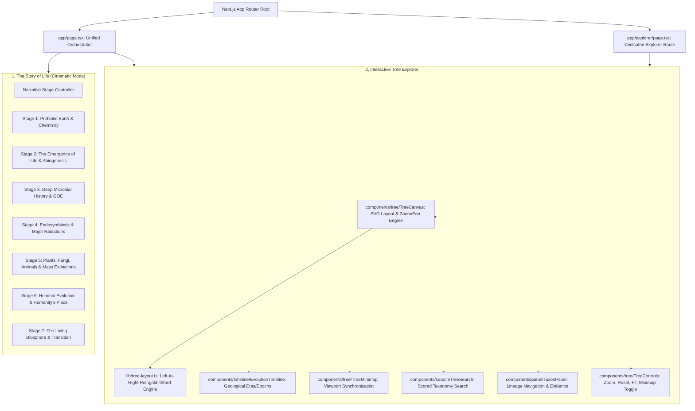

# MASTER PRODUCT REQUIREMENTS DOCUMENT (PRD)
## TREE OF LIFE — The Evolutionary Odyssey of Earth

**Document Version:** 1.0.0  
**Status:** Active Master Specification  
**Project Root:** `tree-of-life`  

---

## 1. Executive Summary & Master Vision

The **Tree of Life** project is a high-craft, scientifically responsible, cinematic and interactive digital exploration of Earth's 3.8+ billion year evolutionary history. 

Unlike traditional top-down organizational charts or speculative visualizations, this application combines:
1. **"The Story of Life"**: A cinematic, multi-stage narrative journey tracing the emergence and evolution of living systems from prebiotic chemistry to modern biodiversity, explicitly respecting scientific limits and uncertainties.
2. **The Interactive Tree Explorer**: A performant, horizontal evolutionary tree visualization expanding left-to-right from LUCA (Last Universal Common Ancestor) outward to modern and extinct lineages, featuring progressive detail, synchronized geological timeline, real-time search, interactive minimap, and deep taxon provenance.

---

## 2. Target User Personas & Experience Pillars

| Persona | Needs & Expectations | Primary Touchpoints |
| :--- | :--- | :--- |
| **Curious General Public / Students** | Engaging visual storytelling, accessible explanations without scientific jargon barriers, intuitive zoom/pan navigation. | Story of Life narrative mode, search suggestions, visual lineage breadcrumbs. |
| **Educators & Science Communicators** | Responsible epistemological framing (differentiating proven fossils from hypotheses), clear geological eras, reliable time ranges. | Geological timeline, taxon panel with evolutionary origin dates, scientific name fidelity. |
| **Academic Enthusiasts & Naturalists** | Phylogenetic precision, correct domain classification, monophyletic representations, absence of teleological bias ("progress toward man"). | Cladistic lineage chains, extinct status notations (†), progressive detail levels (LOD). |

### Core Experience Pillars
- **Scientific Responsibility First**: No fabricated dates, no confusing LUCA with the origin of life, clear demarcation of uncertainty and hypotheses.
- **Cinematic Elegance (Apple / Museum Quality)**: Dark, restrained aesthetic, luminous color accents for clades, buttery 60fps transitions, zero visual clutter.
- **Progressive Detail (Level-of-Detail / LOD)**: Macroscopic structural clarity at wide zooms, granular anatomical and taxonomic depth upon close inspection.
- **Immediate Autonomy**: Users can seamlessly enjoy the narrative or jump immediately into freeform tree exploration with zero forced roadblocks.

---

## 3. Product Architecture & Component Topology

---

## 4. Feature Requirements & Acceptance Criteria

### 4.1 "The Story of Life" — Cinematic Introduction

#### Functional Requirements
1. **7-Stage Scientific Progression**:
   - **Stage 1 (Prebiotic Earth)**: ~4.5–4.0 BYA (Hadean). Magma oceans, hydrothermal systems, volcanic degassing, primordial organic molecule formation.
   - **Stage 2 (Abiogenesis & The Spark of Life)**: ~4.0–3.8 BYA. Transition from chemistry to self-sustaining genetics/metabolism (RNA World hypothesis, alkaline hydrothermal vents). *Strictly marked as an active scientific investigation with no single confirmed model.*
   - **Stage 3 (Deep Microbial Epoch & The Oxygen Revolution)**: ~3.8–2.0 BYA. Archaea and Bacteria rule the planet. Evolution of oxygenic photosynthesis in Cyanobacteria leading to the Great Oxidation Event (GOE ~2.4 BYA).
   - **Stage 4 (Eukaryogenesis & Multicellular Radiations)**: ~2.0–0.6 BYA. Endosymbiotic origin of mitochondria and chloroplasts; emergence of multicellularity; Ediacaran biota.
   - **Stage 5 (Cambrian Explosion, Plants, Fungi & Extinctions)**: ~540–66 MYA. Explosion of animal body plans, conquest of land by bryophytes and vascular plants, fungi symbioses, rise and fall of non-avian dinosaurs across the "Big Five" mass extinctions.
   - **Stage 6 (Hominin Evolution & Human Placement)**: ~7 MYA–Present. Sahelanthropus, Australopithecus, Homo erectus, and Homo sapiens. Explicitly framed not as the "pinnacle" of evolution, but as one small twig on the immense mammal branch.
   - **Stage 7 (The Modern Biosphere & Call to Explore)**: Total overview of known extant and extinct biodiversity, seamlessly morphing into LUCA at the explorer canvas.
2. **Navigation & Flow Controls**:
   - Unmissable **"Skip Introduction / Explore Tree"** button active at every stage.
   - Step forward / backward progress controls with keyboard accessibility (Right/Left Arrow, Space, Enter, Escape to exit).
   - Dynamic timeline indicator highlighting the corresponding geological era during narration.
3. **Accessibility & Media Ethics**:
   - **Zero Autoplay Audio**: No unsolicited sound effects or background music.
   - **Reduced Motion Respect**: When `prefers-reduced-motion: reduce` is active, animations fall back to subtle instant cross-fades without camera swings or particle motion.

#### Acceptance Criteria
- [x] Story mode displays all 7 narrative stages with scientifically sound educational prose.
- [x] Clicking "Skip Introduction" or pressing Escape immediately transitions to the interactive tree without delay.
- [x] The origin of life is explicitly distinguished from LUCA in text and visual framing.
- [x] Mobile/tablet viewports render clear typography and legible buttons without layout overflow.

---

### 4.2 Interactive Tree Explorer

#### Functional Requirements
1. **Horizontal Evolutionary Branching**:
   - Primary orientation: Left-to-right (`x_child > x_parent`).
   - Rooted at LUCA (`x = 80`), expanding through domains (Bacteria, Archaea, Eukaryota) toward modern and extinct tips.
   - Smooth cubic Bezier curves (`M x1 y1 C x1+dx y1, x2-dx y2, x2 y2`) with clade-specific dynamic hue strokes.
2. **Progressive Level of Detail (LOD)**:
   - **Macro Zoom (scale < 0.4)**: Displays major lineage trunks, domain labels, and high-level branch topology; individual leaf labels and secondary sublabels are visually hidden to eliminate visual clutter.
   - **Meso Zoom (0.4 <= scale < 1.1)**: Displays kingdom, phylum, and class nodes with representative common names.
   - **Micro Zoom (scale >= 1.1)**: Displays individual species, scientific binomials, extinction crosses (†), evolutionary origin dates, and interactive hover callouts.
3. **Interactive Viewport Manipulation**:
   - Pan via mouse drag, touchpad scroll, or keyboard pan.
   - Cursor-anchored wheel zooming with configurable damping and clamp boundaries (`scale: 0.15` to `4.0`).
   - "Fit Tree" button calculating the bounding box of all nodes and framing them centered within the viewport.
   - "Reset View" button resetting transform to default coordinates and scale.
4. **Search and Auto-Focus**:
   - Instant search matching common names, scientific names, and taxonomic ranks.
   - Keyboard accessible dropdown (Up/Down arrow navigation, Enter selection, Escape dismissal).
   - Selecting any search result automatically pans and zooms the viewport smoothly to center the selected taxon node with pulse animation.
5. **Synchronized Geological Timeline**:
   - Persistent timeline bar displaying Hadean, Archean, Proterozoic, Paleozoic, Mesozoic, and Cenozoic eras.
   - Marker indicating the approximate temporal position corresponding to the visible tree horizontal depth.
   - Non-overlapping layout guaranteeing tree nodes remain unobstructed.
6. **Synchronized Minimap**:
   - Scaled SVG overview of the tree geometry in bottom corner.
   - Translucent rectangular viewport indicator accurately tracking currently visible canvas bounds.
   - Draggable/clickable minimap for rapid macro-navigation across the tree canvas.
7. **Comprehensive Taxon Information Panel**:
   - Slide-in glassmorphism panel on right side when a node is selected.
   - Displays:
     - Common name and italicized scientific name.
     - Taxonomic rank badge (Domain, Kingdom, Phylum, Class, Order, Family, Genus, Species).
     - Extinction status badge (Extant vs. Extinct †) with dedicated color coding.
     - Estimated evolutionary divergence date (BYA / MYA) with uncertainty qualifier.
     - Curated educational description of ecological role, evolutionary significance, and defining traits.
     - Interactive phylogenetic lineage breadcrumb chain from LUCA down to the selected taxon (clicking any ancestor focuses that node).
     - Direct descendant child taxa buttons (clicking any descendant navigates down the clade).
     - Verified source attribution reference note.

---

## 5. Scientific Accuracy & Epistemological Policy

1. **LUCA vs. Abiogenesis**:
   - **LUCA (Last Universal Common Ancestor)** is defined strictly as the most recent population of organisms from which all organisms currently living on Earth share common descent (~3.8–3.5 BYA).
   - LUCA is NOT the first living entity on Earth. Prior to LUCA existed a rich, undocumented prebiotic history, the emergence of early self-replicating systems, and extensive lateral gene transfer among ancestral lineages that left no modern descendants.
2. **Time Ranges and Dating Conventions**:
   - Dating of ancient evolutionary divergence events is based on molecular clock analyses and radiometric fossil dating, both carrying inherent scientific margins of error.
   - Dates must be presented with the approximate prefix `~` (e.g., `~3.8 BYA`, `~541 MYA`) and accompanied by standard geological epochs.
3. **Cladistics vs. Linnaean Hierarchy**:
   - The tree visualization prioritizes monophyletic clades over artificial rigid rank classifications. Traditional Linnaean terms (e.g., "Phylum", "Class") are provided as educational aids but are not treated as biologically equivalent timeframes.
4. **Non-Teleological Representation**:
   - Evolution is non-directional. *Homo sapiens* must never be depicted as the "goal" or "apex" of the tree. Humans are accurately positioned as a terminal tip of the Hominini tribe within the catarrhine primates, alongside fellow extant primates.

---

## 6. Performance & Accessibility Standards

### 6.1 Performance Budgets
- **Frame Rate**: Steady 60fps during all panning, zooming, and narrative slide transitions.
- **Render Optimization**: Canvas uses SVG with optimized React memoization (`React.memo`, `useMemo`, `useCallback`) to avoid re-rendering inactive nodes during continuous transform updates.
- **Initial Bundle Size**: Zero heavy external 3D libraries (Three.js/Babylon) required for baseline tree exploration; native lightweight SVG + React 19 architecture ensures sub-second initial paint.
- **Memory Footprint**: Layout calculations are memoized once upon dataset load and stored in indexed Maps for $O(1)$ lookups.

### 6.2 Accessibility (a11y)
- **WCAG 2.1 AA Compliance**:
  - Color contrast ratio >= 4.5:1 for all primary and secondary text against dark backgrounds.
  - Visible keyboard focus rings (`outline: 2px solid var(--accent-primary)`) on all interactive nodes, buttons, search inputs, and links.
  - Standard ARIA roles (`role="button"`, `role="complementary"`, `aria-label`, `aria-expanded`).
  - Screen-reader accessible node labels and search feedback.
  - Native browser zoom compatibility (does not crash or clip if user scales browser text to 200%).

---

## 7. Verification & Quality Assurance Strategy

| Category | Verification Method | Pass Criteria |
| :--- | :--- | :--- |
| **Type Integrity** | `npx tsc --noEmit` | Exit code 0, 0 compiler errors. |
| **Lint & Syntax Standards** | `npx eslint .` | Exit code 0, 0 warnings or errors under Next.js 16 / React 19 rules. |
| **Production Build** | `npm run build` | Exit code 0, all static pages generated, zero client hydration mismatch. |
| **Layout Invariants** | Algorithmic invariant tests | $\forall child \in node.children: x_{child} > x_{parent}$. Tree width > 0, height > 0. |
| **Data Integrity** | Tree structure verification | Single root `luca` (`parentId === null`); all non-root nodes have valid `parentId` existing in dataset; zero circular ancestor cycles. |
| **Visual Fidelity** | Headless Chrome screenshot verification | Successful full-canvas capture showing nodes, branches, topbar, timeline, minimap, and taxon panel. |
