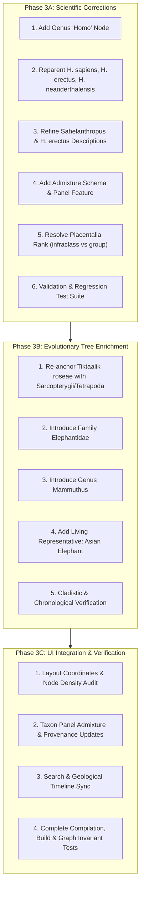

# PHASE 3 IMPLEMENTATION PLAN
## TREE OF LIFE — Scientific Corrections, Evolutionary Enrichment & Architectural Quality

**Document Version:** 1.0.0  
**Date:** 2026-10-25  
**Current Baseline:** 83 validated nodes · Single `luca` root · Clean compilation (0 TS errors, 0 ESLint warnings)  
**Governing Documents:**
- [`docs/MASTER_PRD.md`](file:///c:/Users/HP/Downloads/antigravity/TREE-OF-LIFE/tree-of-life/docs/MASTER_PRD.md)
- [`docs/IMPLEMENTATION_STATUS.md`](file:///c:/Users/HP/Downloads/antigravity/TREE-OF-LIFE/tree-of-life/docs/IMPLEMENTATION_STATUS.md)
- [`docs/SCIENTIFIC_DATA_POLICY.md`](file:///c:/Users/HP/Downloads/antigravity/TREE-OF-LIFE/tree-of-life/docs/SCIENTIFIC_DATA_POLICY.md)
- [`docs/PHASE_2_INTEGRATION_REPORT.md`](file:///c:/Users/HP/Downloads/antigravity/TREE-OF-LIFE/tree-of-life/docs/PHASE_2_INTEGRATION_REPORT.md)
- [`docs/PRE_PHASE_3_SCIENTIFIC_AUDIT.md`](file:///c:/Users/HP/Downloads/antigravity/TREE-OF-LIFE/tree-of-life/docs/PRE_PHASE_3_SCIENTIFIC_AUDIT.md)

---

## 1. Current State Baseline

The Tree of Life project is in a stable, verified operational state:
- **Total Nodes:** Exactly 83 taxa in [`data/tree.ts`](file:///c:/Users/HP/Downloads/antigravity/TREE-OF-LIFE/tree-of-life/data/tree.ts), spanning Bacteria, Archaea, and Eukaryota.
- **Root Node:** Single root `luca` (`parentId === null`); 100% of non-root nodes reference an existing, valid parent.
- **Topological Invariant:** Directed Acyclic Graph (DAG) with zero cycles, verified by automated depth-first traversal.
- **Layout Invariant:** Reingold-Tilford horizontal layout engine strictly maintains $x_{child} > x_{parent}$ across all edges.
- **Application Health:** Next.js 16.4.3 production build passes with static prerendering across all routes (`/`, `/story`, `/explorer`, `/_not-found`). TypeScript 5.x and ESLint 9 report zero errors and zero warnings.

### Pre-Phase 3 Audit Findings Requiring Action
As established in [`docs/PRE_PHASE_3_SCIENTIFIC_AUDIT.md`](file:///c:/Users/HP/Downloads/antigravity/TREE-OF-LIFE/tree-of-life/docs/PRE_PHASE_3_SCIENTIFIC_AUDIT.md):
1. **Hominin Cladistics:** Genus *Homo* is absent; *Homo sapiens*, *Homo erectus*, and *Homo neanderthalensis* are attached directly to Family `hominidae` alongside australopiths and *Sahelanthropus*. Descriptive prose in two hominin entries uses ambiguous "direct ancestor" language that conflicts with modern bushy cladistics.
2. **Genetic Admixture:** Late Pleistocene introgressive hybridization (e.g. 1–2% Neanderthal DNA in Eurasian *H. sapiens*) cannot be depicted through tree bifurcation alone and requires explicit UI contextualization.
3. **Placentalia Rank Inconsistency:** In [`data/tree.ts`](file:///c:/Users/HP/Downloads/antigravity/TREE-OF-LIFE/tree-of-life/data/tree.ts#L996-L1007), `placentalia` is assigned `rank: "order"` while parenting subordinate orders (`proboscidea`, `primates`, `carnivora`, etc.).
4. **Tiktaalik Placement:** *Tiktaalik roseae* is parented directly to `vertebrata` (~525 MYA) rather than a sarcopterygian/tetrapodomorph lineage, and its metadata omits older Middle Devonian trackway evidence (~390 MYA).
5. **Proboscidean Resolution Gap:** The tree jumps directly from Order `proboscidea` (~60 MYA) to Species `mammuthus-primigenius` (~0.4 MYA), omitting Family `elephantidae` and failing to highlight the sister relationship between mammoths and Asian elephants.

---

## 2. Proposed Changes Grouped by Stage



---

### Phase 3A — Scientific Corrections

#### 3A.1 Introduce Genus *Homo* Node
- **Node ID:** `homo`
- **Name:** "Humans & Archaic Relatives" (or "Genus Homo")
- **Scientific Name:** *Homo*
- **Rank:** `genus`
- **Parent ID:** `hominidae`
- **Estimated Origin:** ~2.8 MYA (Stratigraphically calibrated from Ledi-Geraru mandible LD 350-1, Afar, Ethiopia; Villmoare et al., 2015, *Science*).
- **Estimated Origin Mya:** 2.8
- **Status:** `living` (extant through *Homo sapiens*)
- **Icon Emoji:** 🧠
- **Color Hue:** 7 (consistent warm hominine palette)
- **Description:** *"A genus of hominins that emerged in Africa approximately 2.8 million years ago, characterized by marked brain expansion, obligate bipedal endurance, complex stone tool manufacturing, and wide dietary flexibility."*
- **Confidence Notes:** *"Calibrated by early fossil remains (LD 350-1, ~2.8 Ma). Genus Homo represents the lineage uniting modern humans with extinct archaic species including Homo habilis, Homo erectus, and Homo neanderthalensis."*

#### 3A.2 Reparent Hominin Species
Update parent IDs in [`data/tree.ts`](file:///c:/Users/HP/Downloads/antigravity/TREE-OF-LIFE/tree-of-life/data/tree.ts):
- `homo-sapiens`: Parent changes from `hominidae` → `homo`.
- `homo-erectus`: Parent changes from `hominidae` → `homo`.
- `homo-neanderthalensis`: Parent changes from `hominidae` → `homo`.
- `sahelanthropus-tchadensis`: Retained under `hominidae` (divergence ~7.0 MYA).
- `australopithecus-afarensis`: Retained under `hominidae` (divergence ~3.85 MYA).

#### 3A.3 Refine Hominin Metadata to Eliminate Direct-Ancestor Claims
Align descriptive text with [`docs/SCIENTIFIC_DATA_POLICY.md` §1.2](file:///c:/Users/HP/Downloads/antigravity/TREE-OF-LIFE/tree-of-life/docs/SCIENTIFIC_DATA_POLICY.md#L19-L23):
- **`sahelanthropus-tchadensis`**:
  - *Current text:* "One of the earliest known hominin ancestors..."
  - *Revised text:* "An early Miocene hominin positioned near the evolutionary divergence between the chimpanzee and human lineages. Possessing a chimpanzee-sized brain (~350 cm³) and reduced canines, its basicranial geometry indicates upright bipedal tendencies, though its exact locomotion remains actively debated."
  - *Revised Confidence Notes:* "Discovered in Chad in 2001 (TM 266 'Toumaï'). Dated to ~7.0 MYA. Basicranial foramen magnum orientation suggests bipedal posture, but postcranial specimens (femur TM 266-01-063) have prompted debate over whether it was an obligate biped or an early ape with mosaic locomotor adaptations."
- **`homo-erectus`**:
  - *Current text:* "A pioneering ancestor of modern humans who thrived for nearly two million years..."
  - *Revised text:* "A long-lived, highly adaptable Pleistocene human species that mastered fire, prepared cooked food, crafted Acheulean bifacial handaxes, and expanded across Eurasia. Possessing modern body proportions and an expanded braincase, it is intimately connected with the emergence of later hominins."
  - *Revised Confidence Notes:* "Widely recognized as a polytypic taxon spanning ~1.89 Ma to 110 ka. African populations (often classified as Homo ergaster) represent the ancestral stock of Middle Pleistocene hominins, while Asian populations (Homo erectus sensu stricto) represent a persistent, distinct regional radiation."

#### 3A.4 Genetic Admixture Schema & Panel Feature
Model non-tree reticulate gene flow without disrupting the tree's mathematical DAG structure:
1. Extend `types/taxonomy.ts`:
   ```typescript
   export interface AdmixtureEvent {
     targetTaxonId: string;
     targetTaxonName: string;
     percentageRange: string;
     period: string;
     geography: string;
     significance: string;
   }
   ```
   Add optional property to `TaxonNode`:
   ```typescript
   admixtureEvents?: AdmixtureEvent[];
   ```
2. Populate data for `homo-neanderthalensis` and `homo-sapiens`:
   - `homo-neanderthalensis` → `targetTaxonId: "homo-sapiens"`, `percentageRange: "1–2% of nuclear genome"`, `period: "~50,000–60,000 years ago"`, `geography: "Western Asia & Europe"`, `significance: "Adaptive introgression contributing immune (HLA) and keratin alleles to non-African populations."`
3. Update `TaxonPanel.tsx` to render an **"Ancient Admixture & Gene Flow"** information card whenever `admixtureEvents` is present.

#### 3A.5 Resolve `Placentalia` Rank Collision
Evaluate the two scientifically defensible pathways:
- **Option 1 (Recommended): Add `infraclass` to `TaxonomicRank`**.
  - In `types/taxonomy.ts`: Extend `TaxonomicRank` union to include `"infraclass"`.
  - In `lib/tree-utils.ts`: Map `"infraclass"` → `"Infraclass"` in `RANK_DISPLAY`.
  - In `data/tree.ts`: Set `placentalia.rank = "infraclass"`.
  - *Scientific Justification:* Standard mammalian taxonomy (Simpson 1945; Wilson & Reeder 2005; Asher & Helgen 2010) ranks Placentalia as an Infraclass within Subclass Theria, beneath Class Mammalia. This eliminates the Order-parents-Order collision while maintaining strict Linnaean ranks.
- **Option 2 (Alternative): Assign existing `rank: "group"`**.
  - Set `placentalia.rank = "group"`.
  - *Scientific Justification:* Treats Placentalia as an unranked crown clade.
  - *Trade-off:* Avoids modifying `TaxonomicRank`, but renders "Group" instead of a formal rank in the UI.
- *Strict Rule:* Placentalia will **NOT** be classified as a Class.

#### 3A.6 Validation Suite for Stage 3A
- Run TypeScript compiler: `npx tsc --noEmit` (0 errors).
- Run linter: `npm run lint` (0 errors, 0 warnings).
- Automated graph checks: Single root `luca`, zero cycles, 84 nodes total (83 baseline + 1 `homo`), all parent-child references valid.

---

### Phase 3B — Evolutionary Tree Enrichment

#### 3B.1 Scientifically Defensible Placement for *Tiktaalik roseae*
- **Problem Statement:** *Tiktaalik* is a Late Devonian elpistostegalian (~375 MYA) currently parented directly to `vertebrata` (~525 MYA). This isolates it from lobe-finned fish (*Sarcopterygii*) and land vertebrates (*Tetrapoda*).
- **Options Evaluated:**
  - **Option A (Introduce Clade `sarcopterygii`)**:
    - Add Clade `sarcopterygii` (Lobe-Finned Fish & Tetrapods; rank: `class` or `group`, parent: `vertebrata`, origin: ~420 MYA).
    - Anchor both `tiktaalik-roseae` and crown terrestrial tetrapods under `sarcopterygii`.
    - *Impact:* Cladistically rigorous (Benton 2015; Janvier 1996), but requires reparenting `amphibia`, `reptilia`, and `synapsida` under `sarcopterygii`.
  - **Option B (Introduce Stem-Clade `tetrapodomorpha`)**:
    - Add `tetrapodomorpha` (rank: `group`, parent: `vertebrata`, origin: ~400 MYA).
    - Parent `tiktaalik-roseae` and early tetrapods beneath it.
  - **Option C (Retain under `vertebrata` with enriched transitional metadata)**:
    - Retain `parentId: "vertebrata"` to prevent widespread tree restructuring, but update `confidenceNotes` to explicitly define its stem-sarcopterygian position and contrast it with older Middle Devonian trackway evidence (~390 MYA; Niedźwiedzki et al., 2010, *Nature*).
- **Recommendation:** Submit Options A and C to user review. If Option A is approved, implement Sarcopterygii as the unifying clade.

#### 3B.2 Proboscidea Hierarchy Enrichment
Introduce intermediate taxa supported by robust fossil and paleogenomic consensus:
1. **Family `elephantidae`**:
   - **Node ID:** `elephantidae`
   - **Name:** "Elephants & Mammoths"
   - **Scientific Name:** *Elephantidae*
   - **Rank:** `family`
   - **Parent ID:** `proboscidea`
   - **Estimated Origin:** ~7.0–9.0 MYA (Late Miocene fossil teeth in Africa; Shoshani et al., 2006; Thomas et al., 2008).
   - **Estimated Origin Mya:** 8.0
   - **Status:** `living` (represented today by *Loxodonta* and *Elephas*)
   - **Icon Emoji:** 🐘
   - **Color Hue:** 27
   - **Description:** *"The family of large herbivorous mammals comprising modern African and Asian elephants, extinct mammoths, and their immediate fossil kin. Possesses high-crowned lamellar molars specialized for abrasive grasses."*
2. **Genus `mammuthus` (Optional Intermediate Step)**:
   - **Node ID:** `mammuthus`
   - **Name:** "Mammoths"
   - **Scientific Name:** *Mammuthus*
   - **Rank:** `genus`
   - **Parent ID:** `elephantidae`
   - **Estimated Origin:** ~5.0 MYA (Pliocene of Africa, ancestral *Mammuthus subplanifrons*; Lister et al., 2005).
   - **Estimated Origin Mya:** 5.0
   - **Status:** `extinct` († 4,000 YA)
   - **Description:** *"A genus of extinct elephantids that originated in Pliocene Africa before radiating across Eurasia and North America, culminating in cold-adapted Ice Age steppe mammoths."*
3. **Reparent `mammuthus-primigenius`**:
   - Parent changes from `proboscidea` → `mammuthus` (or `elephantidae` if genus node is omitted to conserve density).
4. **Living Representative: Asian Elephant (*Elephas maximus*)**:
   - **Node ID:** `elephas-maximus`
   - **Name:** "Asian Elephant"
   - **Scientific Name:** *Elephas maximus*
   - **Rank:** `species`
   - **Parent ID:** `elephantidae`
   - **Estimated Origin:** ~2.6 MYA (Pleistocene of southern Asia).
   - **Estimated Origin Mya:** 2.6
   - **Status:** `living` (IUCN: Endangered)
   - **Icon Emoji:** 🐘
   - **Color Hue:** 29
   - **Description:** *"The largest living land animal in Asia. Paleogenomic sequencing proves that Asian elephants share closer evolutionary kinship with extinct woolly mammoths than with African elephants."*
   - **Visual Asset:** Verified Creative Commons image from Wikimedia Commons / Smithsonian.

---

### Phase 3C — UI and Regression Testing

#### 3C.1 Layout Invariants & Node Density Analysis
- **Horizontal Coordinate Progression:**
  - Formula: $x = \text{ROOT\_X} + \text{depth} \times \text{NODE\_WIDTH}$ ($\text{NODE\_WIDTH} = 220\text{px}$).
  - Adding Genus `homo` increases depth by 1 for *H. sapiens*, *H. erectus*, *H. neanderthalensis*, shifting their x-coordinate by +220px.
  - Adding `elephantidae` and `mammuthus` shifts *M. primigenius* by +220px to +440px.
  - The Reingold-Tilford layout engine (`lib/tree-layout.ts`) calculates bounding boxes dynamically:
    - Total canvas width expands from 2,700px to approximately 3,140px.
    - Total canvas height expands by ~56px to 112px for added sibling leaves.
    - Invariant $\forall \text{edge}: x_{child} > x_{parent}$ remains mathematically guaranteed.
- **Progressive Level-of-Detail (LOD):**
  - LOD thresholds in `TreeCanvas.tsx`:
    - Macro scale (< 0.45): Renders domains and phyla.
    - Meso scale (0.45–0.85): Renders classes, orders, and families (including newly added `elephantidae` and `homo`).
    - Micro scale (>= 0.85): Renders full species binomials and dates.

#### 3C.2 UI Component Updates
- **`components/panel/TaxonPanel.tsx`**: Add dedicated rendering block for `admixtureEvents`.
- **`lib/tree-utils.ts`**: Update `RANK_DISPLAY` with `"infraclass"` if approved.
- **`docs/IMAGE_ATTRIBUTION.md`**: Catalog new asset for *Elephas maximus* with verified license (e.g., CC-BY-SA 4.0).
- **`EvolutionTimeline.tsx`**: Verify that origin dates (2.8 MYA, 8.0 MYA, 2.6 MYA) align smoothly with the Cenozoic/Quaternary markers.

#### 3C.3 Verification Test Suite
Execute the following verification scripts and compiler commands:
1. `npx tsc --noEmit` — Strict TypeScript validation.
2. `npm run lint` — ESLint 9 / React 19 cascading-render validation.
3. `npm run build` — Turbopack production compilation and static page generation.
4. `scripts/verify-phase3.ts` — Automated verification checking:
   - Exactly 1 root (`luca`).
   - 100% bidirectional parent-child references.
   - Zero circular references (cycle detection).
   - Strict horizontal ordering ($x_{child} > x_{parent}$).
   - Scored search tests for all new and modified taxa (`Homo`, `Elephantidae`, `Elephas maximus`).
   - Chronological origin/extinction consistency ($t_{extinction} \le t_{origin}$).

---

## 3. Node Inventory Comparison Table

| Phase | Total Nodes | Key Structural Changes | Primary Additions |
| :--- | :--- | :--- | :--- |
| **Phase 1** | 64 | Foundational tree across 3 domains | LUCA, cyanobacteria, dinos, humans, cats |
| **Phase 2** | 83 | Cladistic corrections for Smilodon, Dimetrodon, Trilobites | *Dickinsonia*, *Anomalocaris*, *Tiktaalik*, *T. rex*, *Smilodon*, *Mammuthus*, *H. erectus*, *H. neanderthalensis*, *Sahelanthropus*, *Lucy* |
| **Phase 3 (Proposed)** | **86–88** | Genus *Homo*, Proboscidea enrichment, Placentalia rank fix | Genus `homo`, Family `elephantidae`, (optional Genus `mammuthus`), *Elephas maximus*, (optional Clade `sarcopterygii`) |

---

## 4. Evidence Requirements for Uncertain Relationships

Before committing any phylogenetic placement to `data/tree.ts`, the following evidentiary standards must be satisfied:

| Lineage / Placement | Type of Evidence Required | Authoritative Literature |
| :--- | :--- | :--- |
| **Genus *Homo* monophyly** | Cranial, mandibular, and dental synapomorphies | Villmoare et al. (2015) *Science*; Wood & Collard (1999) *Science* |
| **Archaic Human Admixture** | High-coverage ancient nuclear genome alignments | Green et al. (2010) *Science*; Prüfer et al. (2014) *Nature* |
| **Elephantidae Monophyly & Asian Elephant Kinship** | Complete mitochondrial and nuclear genomic sequencing | Krause et al. (2006) *Nature*; Palkopoulou et al. (2018) *PNAS* |
| **Middle Devonian Tetrapod Trackways** | Stratigraphically verified, sedimentologically documented trackways | Niedźwiedzki et al. (2010) *Nature* |
| **Infraclass Placentalia** | Morphological & molecular classification consensus | Wilson & Reeder (2005); Asher & Helgen (2010) *J. Mammal.* |

---

## 5. Files Likely to Change

| File Path | Nature of Modification in Phase 3 |
| :--- | :--- |
| [`types/taxonomy.ts`](file:///c:/Users/HP/Downloads/antigravity/TREE-OF-LIFE/tree-of-life/types/taxonomy.ts) | Add `"infraclass"` to `TaxonomicRank`; add `AdmixtureEvent` interface to `TaxonNode`. |
| [`lib/tree-utils.ts`](file:///c:/Users/HP/Downloads/antigravity/TREE-OF-LIFE/tree-of-life/lib/tree-utils.ts) | Add `"infraclass": "Infraclass"` to `RANK_DISPLAY`. |
| [`data/tree.ts`](file:///c:/Users/HP/Downloads/antigravity/TREE-OF-LIFE/tree-of-life/data/tree.ts) | Add approved nodes (`homo`, `elephantidae`, `elephas-maximus`); reparent children; refine text descriptions. |
| [`components/panel/TaxonPanel.tsx`](file:///c:/Users/HP/Downloads/antigravity/TREE-OF-LIFE/tree-of-life/components/panel/TaxonPanel.tsx) | Render ancient admixture card for hominins when `admixtureEvents` is present. |
| [`docs/IMAGE_ATTRIBUTION.md`](file:///c:/Users/HP/Downloads/antigravity/TREE-OF-LIFE/tree-of-life/docs/IMAGE_ATTRIBUTION.md) | Log asset license for *Elephas maximus*. |
| [`docs/IMPLEMENTATION_STATUS.md`](file:///c:/Users/HP/Downloads/antigravity/TREE-OF-LIFE/tree-of-life/docs/IMPLEMENTATION_STATUS.md) | Update progression matrix upon Phase 3 completion. |
| `scripts/verify-phase3.ts` | Verification script for Phase 3 invariants. |

---

## 6. Regression Risks & Mitigation Strategies

| Risk | Potential Consequence | Mitigation Strategy |
| :--- | :--- | :--- |
| **Tree Cycle Formation** | Infinite loop in layout engine; application crash. | Automated cycle detection in test script traverses ancestor chains before rendering. |
| **Broken Parent References** | Node orphaned from tree; layout engine omits branch. | Bi-directional reference validation asserting `nodeMap[node.parentId].childIds.includes(node.id)`. |
| **Horizontal Overlap** | Node labels overlapping or crossing branch paths. | Reingold-Tilford engine uses depth multiplier ($depth \times 220\text{px}$); sibling gap enforced by leaf accumulator. |
| **Type Incompatibilities** | TypeScript compilation failures on `TaxonomicRank`. | Ensure all rank-handling functions (`getRankDisplay`, search, badge styling) handle `"infraclass"` safely with fallback defaults. |
| **Offline Font/Asset Failures** | Next.js build crash during static optimization. | Local asset bundling; zero remote Google Font fetches at build time. |

---

## 7. Acceptance Criteria for Each Stage

### Stage 3A Acceptance Criteria
- [ ] Genus node `homo` is present with `rank: "genus"` and `parentId: "hominidae"`.
- [ ] `homo-sapiens`, `homo-erectus`, and `homo-neanderthalensis` have `parentId === "homo"`.
- [ ] `sahelanthropus-tchadensis` and `homo-erectus` descriptions no longer use unqualified "direct ancestor" claims.
- [ ] `homo-sapiens` and `homo-neanderthalensis` display ancient admixture information in the slide-over panel.
- [ ] `placentalia` rank collision resolved without invalid classification as a class.
- [ ] `npx tsc --noEmit` and `npm run lint` pass with 0 errors.

### Stage 3B Acceptance Criteria
- [ ] `tiktaalik-roseae` classification and metadata accurately distinguish morphological transition from lineal ancestry, citing Devonian trackway chronology.
- [ ] Family `elephantidae` is integrated under `proboscidea`.
- [ ] `mammuthus-primigenius` is correctly placed under `elephantidae` (or Genus `mammuthus`).
- [ ] Living representative (*Elephas maximus*) integrated with verified open-license visual asset.
- [ ] Single root `luca` maintained; zero orphaned nodes; zero cycles.

### Stage 3C Acceptance Criteria
- [ ] Tree canvas renders smoothly at 60fps with non-overlapping horizontal coordinates.
- [ ] Scored search retrieves all newly added taxa (`Homo`, `Elephantidae`, `Asian Elephant`).
- [ ] Minimap and geological timeline synchronize accurately across all depths.
- [ ] `npm run build` succeeds with zero errors and static pre-rendering.
- [ ] Full documentation updated (`docs/IMPLEMENTATION_STATUS.md` and Phase 3 completion report).

---

## 8. Questions Requiring User Approval Before Implementation

Before proceeding to execution, user guidance is solicited on the following scientific and architectural design decisions:

1. **`Placentalia` Taxonomic Rank Selection:**
   - *Option A (Recommended):* Add `"infraclass"` to `TaxonomicRank` in `types/taxonomy.ts` and set `placentalia.rank = "infraclass"`.
   - *Option B:* Keep `TaxonomicRank` unchanged and set `placentalia.rank = "group"`.
   - *Which approach do you prefer?*

2. ***Tiktaalik* Sarcopterygian Restructuring vs. Metadata Enrichment:**
   - *Option A:* Introduce Clade `sarcopterygii` (rank: `class` or `group`) beneath `vertebrata`, reparenting `tiktaalik-roseae`, `amphibia`, `reptilia`, and `synapsida` beneath it to achieve maximum cladistic monophyly.
   - *Option B (Recommended for stability):* Retain `tiktaalik-roseae` under `vertebrata` to maintain the existing broad vertebrate layout, but enrich its description and confidence notes with explicit stem-sarcopterygian classification and the ~390 MYA Zachelmie trackway evidence.
   - *Do you approve Option B, or should we execute full Sarcopterygii clade restructuring (Option A)?*

3. **Proboscidea Resolution Granularity:**
   - *Option A (Direct Family):* `proboscidea` (Order) → `elephantidae` (Family) → `mammuthus-primigenius` & `elephas-maximus` (Species). *(Adds 2 nodes: 1 family + 1 species).*
   - *Option B (Full Genus):* `proboscidea` (Order) → `elephantidae` (Family) → `mammuthus` (Genus) → `mammuthus-primigenius` (Species). *(Adds 3 nodes: 1 family + 1 genus + 1 species).*
   - *Do you prefer Option A (cleaner density) or Option B (full Linnaean hierarchy)?*
